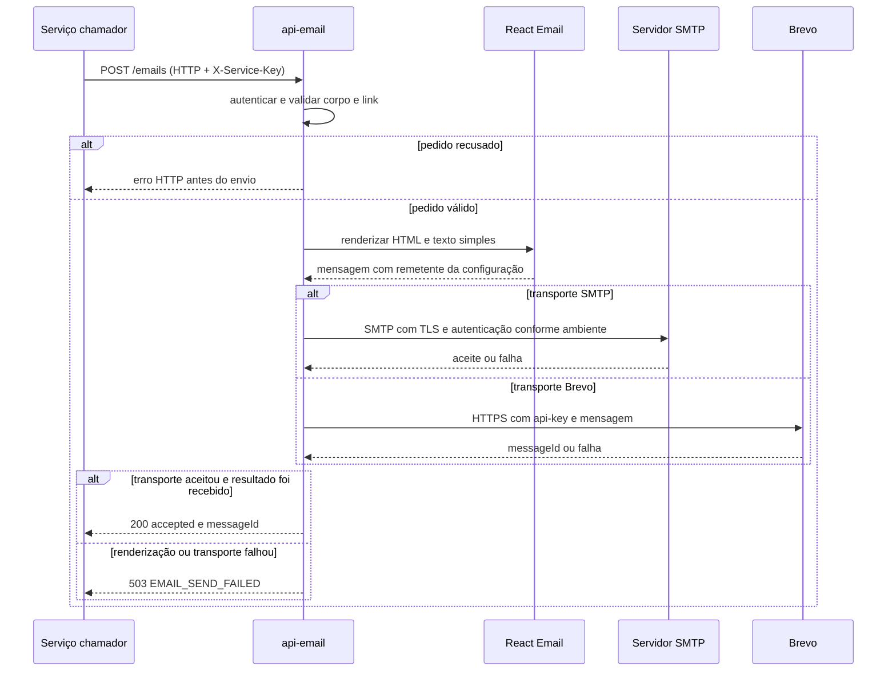

  

# Envio de e-mail

O serviço chamador fornece modelo, idioma, destinatário e contexto. A API valida o pedido, monta a mensagem e aguarda uma resposta do transporte selecionado. Não grava histórico nem comprova entrega na caixa postal.

Em SMTP, as imagens incorporadas são convertidas pelo Nodemailer em partes CID. Em Brevo, o adaptador substitui as referências incorporadas e cria os anexos internos correspondentes. O payload recebido não permite anexos arbitrários.

O fluxo do convite de projeto está em [PROJECT_INVITE_EMAIL.md](https://github.com/Solierrr/docs-warehouse/blob/main/docs/flows/PROJECT_INVITE_EMAIL.md). A participação deste serviço termina no aceite ou falha do transporte. As tentativas do worker de convites pertencem ao chamador.

## Casos de erro

- Autenticação ou validação recusada não chama o transporte.
- Falha ao renderizar no caminho de envio é convertida em 503 pela rota.
- Rejeição SMTP, resposta Brevo inválida ou timeout recebe 503 sem detalhes do provedor.
- Timeout após aceite pode deixar a mensagem enviada sem confirmação para o chamador. Repetir pode duplicar o envio.
- Não há tentativa automática nem deduplicação neste serviço. A política continua pendente. <!-- PENDENTE: 4 -->
