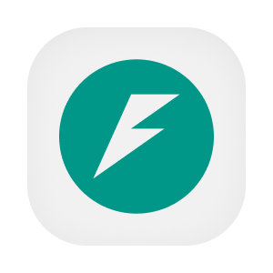
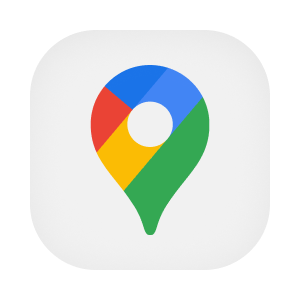

  

  
  
  
  
  
  
  

# Integração com serviços Google

Este serviço reúne consultas a ferramentas do Google usadas pela plataforma. Pessoas podem buscar, conferir e localizar endereços, consultar o fuso horário de uma coordenada e obter informações sobre a capacidade solar de um telhado. Os serviços da plataforma também podem traduzir textos entre português, inglês e espanhol. A centralização evita que cada consumidor precise manter sua própria integração com os provedores.

A API usa FastAPI e devolve os resultados sem guardar os dados consultados. As operações de endereço e fuso recebem o JWT do serviço de autenticação. As operações internas de tradução e energia solar recebem uma chave do serviço chamador. As consultas externas passam pelas APIs de mapas, validação de endereço, tradução e energia solar do Google.

## Aprofunde-se no Projeto!

- [OVERVIEW.md](./docs/OVERVIEW.md), capacidades e regras vistas por quem usa a plataforma.
- [ARCHITECTURE.md](./docs/ARCHITECTURE.md), camadas, integrações e decisões técnicas.
- [RUNNING.md](./docs/RUNNING.md), execução e testes locais.
- [API.md](./docs/API.md), autenticação, grupos de operações e erros.
- [DEPLOY.md](./docs/DEPLOY.md), ambientes e publicação.
- [STATUS.md](./docs/STATUS.md), limitações verificadas no código.
- [Fluxos](./flows/), consulta de endereço, fuso, tradução e energia solar.

## Contribuindo

- [CONTRIBUTING.md](https://github.com/Solierrr/.github/blob/main/.github/CONTRIBUTING.md), convenções de commit, branch e Pull Request.
- [CODE_OF_CONDUCT.md](https://github.com/Solierrr/.github/blob/main/CODE_OF_CONDUCT.md), código de conduta.
- [SECURITY.md](https://github.com/Solierrr/.github/blob/main/SECURITY.md), como reportar uma vulnerabilidade.
