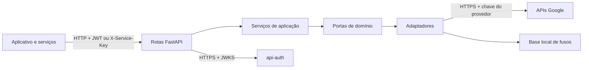

  

# Arquitetura

O servidor FastAPI separa contratos de domínio, orquestração, adaptadores e rotas HTTP. Clientes HTTP são criados na inicialização. Endereços, tradução e energia solar usam APIs Google, enquanto o fuso usa uma base local. Não há banco próprio.

## Pastas

| Pasta | Papel |
|---|---|
| `app/api/routers/` | Rotas, autenticação e validação de entrada. |
| `app/application/` | Casos de uso por capacidade. |
| `app/domain/` | Contratos dos provedores. |
| `app/infrastructure/google/` | Adaptação das APIs externas. |
| `app/infrastructure/http/` | Clientes com timeout e repetição. |
| `app/infrastructure/auth/` | JWT e chaves de serviço. |
| `app/infrastructure/geo/` | Fusos locais. |
| `app/schemas/` | Modelos de entrada e saída. |

## Integrações

| Relação | Protocolo | Autenticação |
|---|---|---|
| Aplicativo e portal de QA → serviço | HTTP | JWT de usuário. |
| `api-core` → tradução | HTTP | `X-Service-Key`. |
| `ai-geographic` → energia solar | HTTP | `X-Service-Key`. |
| Serviço → `api-auth` | HTTP | JWKS público para validar JWT. |
| Serviço → APIs Google | HTTPS | Chave do provedor. |

O cliente de token do Calendar existe, mas nenhuma rota o usa. <!-- PENDENTE: 2 --> O [fluxo compartilhado](https://github.com/Solierrr/docs-warehouse/blob/main/docs/flows/SERVICE_TO_SERVICE_AUTH.md) descreve chamadas entre serviços.

## Decisões e operação

O `AddressService` combina Places, Geocoding e Address Validation. Uma falha na validação durante a resolução mantém o endereço e devolve `validation: null`. O `TranslationService` agrupa textos por idioma de destino. O cliente Google repete falhas transitórias até três vezes nas operações permitidas. `tzfpy` e `ZoneInfo` calculam fusos sem consumir quota externa.

`/health` informa a versão de `version.txt`. `/ready` verifica a criação dos clientes HTTP sem chamar o Google. OpenTelemetry registra traces, logs e métricas. A chave em URLs é ocultada nos registros. O contrato público oculta `/internal`, e o exportado inclui essas rotas.
