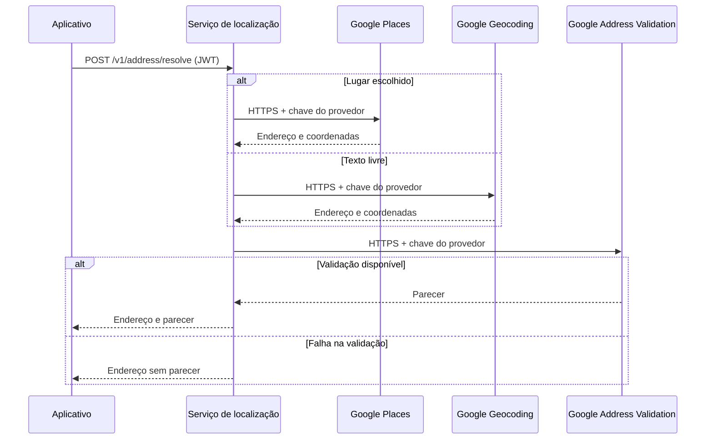

  

# Consulta de endereço

A pessoa informa um texto ou escolhe uma sugestão. O serviço consulta Places ou Geocoding, estrutura o endereço e tenta validá-lo. O resultado volta para o cliente sem ser salvo neste serviço.

## Casos de erro

Lugar ou texto sem resultado retorna 404. JWT ausente ou inválido retorna 401. Falha de localização no provedor retorna erro de dependência. A falha da validação após localizar o endereço não descarta o endereço.
