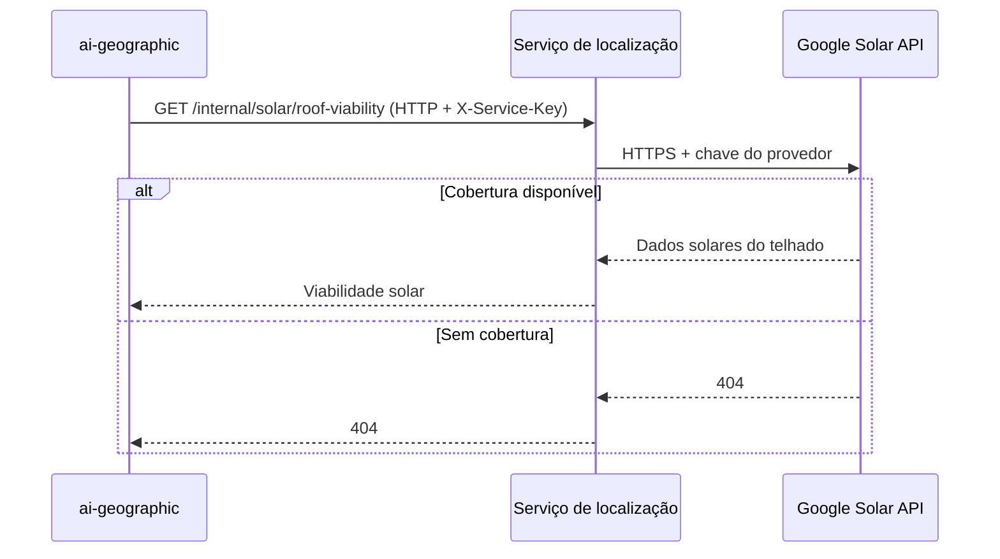

  

# Consulta solar

O serviço geográfico envia coordenadas. A API consulta o telhado mais próximo coberto pelo provedor e devolve os dados solares. O [mapa de integrações](https://github.com/Solierrr/docs-warehouse/blob/main/docs/flows/INTEGRATIONS.md) situa essa chamada entre os serviços.

## Casos de erro

Chave ausente ou inválida retorna 401. Chamador sem permissão retorna 403. Coordenada inválida retorna 422. Sem cobertura solar, a chamada retorna 404. Falha do provedor retorna erro de dependência.
