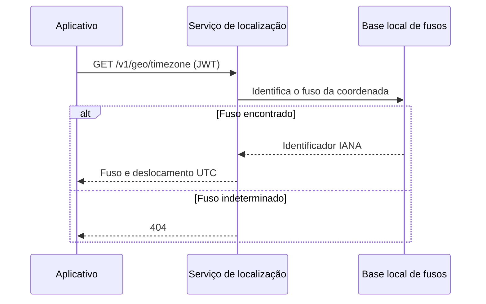

  

# Consulta de fuso horário

O cliente envia coordenadas e, se necessário, um instante. O serviço consulta uma base local de fusos e calcula o deslocamento UTC daquele instante, sem chamar o Google.

## Casos de erro

Coordenadas inválidas retornam 422. Fuso indeterminado retorna 404. Sem JWT válido, a chamada retorna 401. Se o JWKS não estiver disponível, a autenticação retorna 503.
