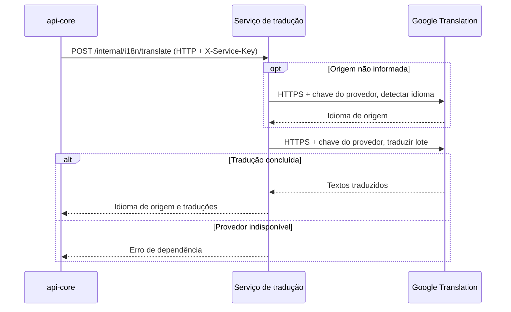

  

# Tradução de campos

O serviço de negócio envia campos de texto. A origem é detectada quando não é informada. O serviço traduz cada campo para os demais idiomas suportados e devolve a resposta ao chamador. O [fluxo entre serviços](https://github.com/Solierrr/docs-warehouse/blob/main/docs/flows/SERVICE_TO_SERVICE_AUTH.md) detalha a autenticação compartilhada.

## Casos de erro

Uma chave ausente ou inválida retorna 401 e a chave de outro chamador retorna 403, enquanto uma entrada inválida retorna 422 e uma falha do Google retorna erro de dependência.