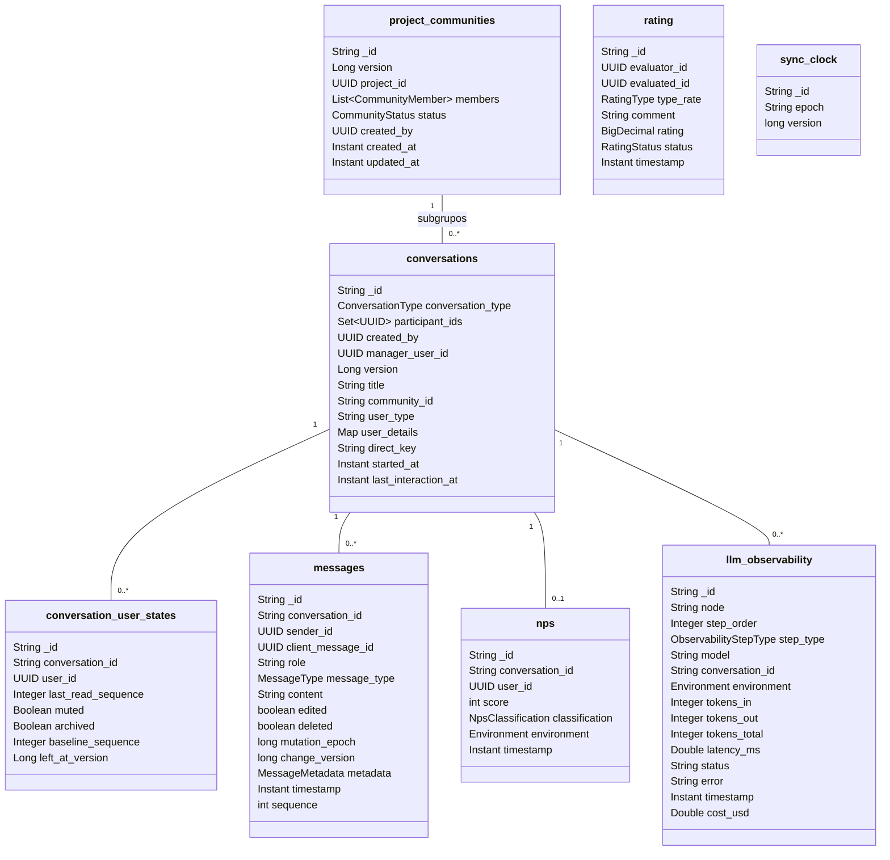

  

# MongoDB

Banco `solaria_messenger_db` (nome configurável por `DB_MONGO_MESSENGER`), com nove coleções. Só este serviço lê e escreve nelas. As pessoas são identificadas pelo `authId`, o UUID do `sub` do JWT do `api-auth`, gravado com `uuidRepresentation=standard`. Conversas, mensagens e comunidades usam ObjectId em hexadecimal.

## `conversations`

Cada conversa é um documento, com `conversation_type` igual a `DIRECT`, `GROUP` ou `CHAT_BOT`, e um grupo que fica sem participantes é apagado junto com as suas mensagens e os estados pessoais ligados a ele.

- `DIRECT` tem exatamente dois participantes, nunca fica numa comunidade e tem `direct_key` com os dois UUIDs ordenados e unidos por `|`.
- `GROUP` nasce com dois ou mais participantes e o criador como `manager_user_id`. Com `community_id`, é um subgrupo. Pode ficar vazio, com gestor nulo.
- `CHAT_BOT` tem só o dono, sem gestor e sem estado pessoal. `user_type` e `user_details` vêm de quem cria. `user_details.assistant` identifica o assistente.

| Índice | Uso |
|---|---|
| `participant_ids` | conversas de uma pessoa |
| `community_id` | subgrupos de uma comunidade |
| `uq_direct_pair`, `direct_key` único parcial para `DIRECT` | uma direta por par |

`version` é a condição das escritas de participantes, gestor e reativação. `last_interaction_at` só cresce (`$max`).

## `conversation_user_states`

O estado de cada participante numa conversa direta ou de grupo. Nasce na admissão com `baseline_sequence` e `last_read_sequence` iguais à última `sequence` da conversa, sem silêncio nem arquivo. `last_read_sequence` só cresce. `left_at_version` recebe a versão do relógio quando a pessoa sai e é limpo quando ela volta. O estado nunca é apagado.

| Índice | Uso |
|---|---|
| `uq_conversation_user_state`, `conversation_id` e `user_id` único | um estado por participante |

## `messages`

Uma mensagem por documento. `message_type` é `USER_TO_USER`, `USER_TO_GROUP`, `USER_TO_CHATBOT` ou `CHATBOT_TO_USER`, e `role` é `user` ou `assistant`. `sequence` começa em 1 em cada conversa. A mensagem apagada fica com `deleted = true` e sem `content`. `mutation_epoch` cresce a cada edição ou exclusão, e documento sem o campo vale 0. `change_version` guarda a versão do relógio da última mudança, e documento sem o campo vale 0. `metadata` vem do pipeline de IA, com `turnId`, `contentAnonymized`, `specialistsUsed`, `workflowSteps` e `threadTurn`.

| Índice | Uso |
|---|---|
| `conversation_id` | histórico e última mensagem |
| `conversation_sequence_idx`, `conversation_id` e `sequence` único | uma mensagem por posição |
| `conversation_change_version_idx`, `conversation_id` e `change_version` | catch-up por versão |

## `project_communities`

Uma comunidade por projeto técnico do `api-core`. `members` traz `user_id`, `role` (`OWNER`, `ADMIN` ou `MEMBER`) e `joined_at`. `status` é `ACTIVE` ou `ARCHIVED`, e `version` é a condição das escritas de membros e status.

| Índice | Uso |
|---|---|
| `project_id` único | uma comunidade por projeto |
| `project_community_member_idx`, `members.user_id` | comunidades de uma pessoa |

## `rating`, `nps` e `llm_observability`

- `rating` guarda a avaliação de um profissional ou de um produto, com nota de 0 a 5 e status `ACTIVE`, `EXCLUDED` ou `DOWN`. Índices em `evaluator_id` e `evaluated_id`.
- `nps` guarda a nota de 0 a 10 de uma conversa com o assistente e a classificação (`DETRACTOR`, `PASSIVE` ou `PROMOTER`). Índice único em `conversation_id` e índice em `user_id`.
- `llm_observability` guarda cada etapa do pipeline de LLM (`LLM_CALL` ou `TOOL_CALL`). Índices em `node` e `conversation_id`. O histórico administrativo lê esta coleção junto com `messages` e `nps`.

## `sync_clock`

Um documento só, `_id: "conversation-sync"`. `version` cresce por `findAndModify` com `$inc`, e `epoch` é um UUID gravado no primeiro uso, que só muda se o documento for perdido.

## Índices na partida

Os índices declarados nas classes são criados com `spring.data.mongodb.auto-index-creation=true`. Antes disso, o `MessageSequenceIndexRepository` converte o índice antigo de sequência em único, o `ConversationIndexRepository` troca a unicidade antiga da direta pela nova e o `MessageIndexRepository` remove o índice antigo de deduplicação. Se houver duplicata ou definição inesperada, o serviço não sobe, e nada é apagado nem mesclado.
