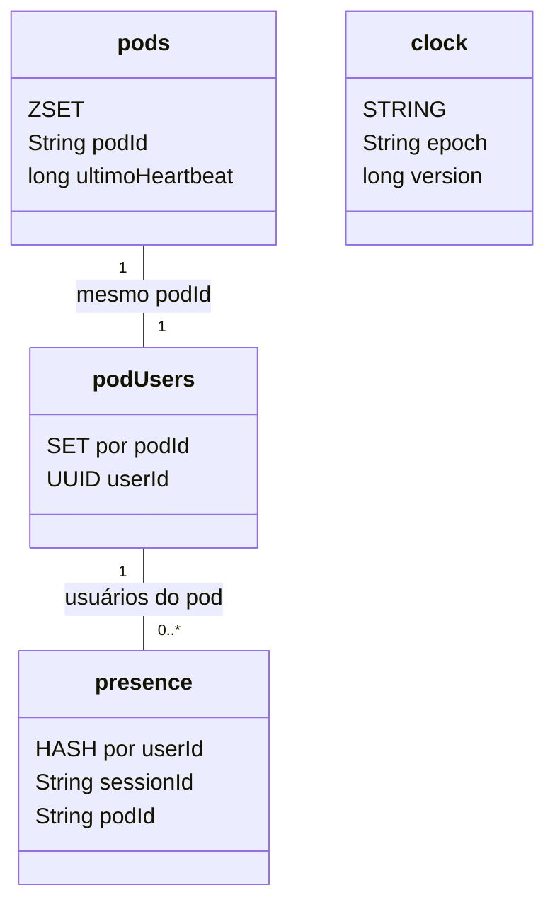

  

# Redis

O Redis guarda a presença das pessoas conectadas, o canal de revogação de sessões e a confirmação de que um usuário está ativo. A instância é a mesma Upstash do `api-core`, com usuário próprio, e as chaves deste serviço começam com `messenger:`. Nenhum dado de domínio fica aqui, então perder o Redis reduz a presença à visão de cada instância e faz o `ActiveUserFilter` consultar o `api-auth` em toda requisição.

| Chave | Tipo | Uso |
|---|---|---|
| `messenger:presence:{userId}` | HASH `sessionId` para `podId` | a pessoa está online quando o hash tem algum campo. O tamanho dele é a contagem de sessões |
| `messenger:pod-users:{podId}` | SET de `userId` | as pessoas com sessão na instância, para limpar a instância morta |
| `messenger:pods` | ZSET `podId` com o último heartbeat em ms | detecção de instância sem heartbeat por 90 s |
| `messenger:presence:epoch` | STRING | época da presença, recriada se o Redis perder os dados |
| `messenger:presence:version` | STRING com contador | versão dos eventos de presença |
| `messenger:reap:{podId}` | STRING com `SET NX` e TTL de 10 min | trava para que uma só instância limpe a instância morta |
| `messenger:active:{userId}` | STRING com TTL de 30 s | a Auth confirmou a pessoa como ativa, e o `ActiveUserFilter` pula a consulta enquanto a chave existir |
| `messenger:revoke` | canal Pub/Sub, corpo `origin:userId` | revogação das sessões de uma pessoa em todas as instâncias |

O `podId` é um UUID gerado por processo, então um container reiniciado não herda as sessões do anterior. O `RedisPresenceStore` escreve as chaves de presença, o `WebSocketSessionRevoker` publica e ouve o canal, e o `ActiveUserFilter` escreve e lê a confirmação de usuário ativo.
