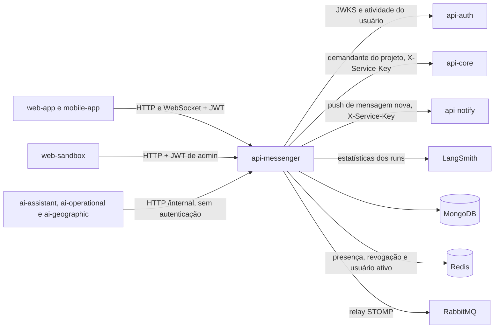

  

  
  
  

# Arquitetura

Serviço Spring Boot 4.1 em Java 21, com MongoDB, Redis e WebSocket STOMP. As rotas `/messaging/**` atendem as pessoas com o JWT do `api-auth`. As rotas `/internal/**` atendem os assistentes virtuais, sem autenticação de aplicação, protegidas pela rede. O tempo real usa um relay STOMP para o RabbitMQ quando há mais de uma instância, e o broker em memória do Spring quando há uma só.

## Pastas

O código fica em `src/main/java/com/solaria/messenger/`, em portas e adaptadores com três pacotes de topo.

- **`core/`** guarda modelo, repositórios, casos de uso e clientes de outros serviços. Não importa `rest/` nem `websocket/`. Declara em `core/port` as portas de saída que `websocket/` implementa.
- **`rest/`** é o adaptador HTTP. Recebe as requisições, valida o corpo e chama os casos de uso. Também concentra a segurança HTTP, o tratamento de erro e o Swagger.
- **`websocket/`** é o adaptador STOMP. Recebe os comandos `/app/*`, chama os mesmos casos de uso e implementa as portas de publicação de eventos, revogação de sessões e presença.

Os dois adaptadores executam as mesmas regras. Mandar mensagem por `POST /messaging/messages` ou por `/app/messages.send` chama o `SendUserMessageUseCase`, com os mesmos códigos de erro.

| Pasta | Papel |
|---|---|
| `core/usecase/` | um caso de uso por operação (`SendUserMessageUseCase`, `CreateDirectConversationUseCase`, `RemoveCommunityMemberUseCase`), agrupados em `admin`, `community`, `conversation`, `group`, `message`, `nps`, `observability` e `rating` |
| `core/helper/` | regras compartilhadas entre casos de uso: acesso (`ConversationAccessHelper`), admissão em transação (`ConversationAdmissionHelper`), escrita de mensagem (`MessageWriteHelper`), notificação (`NotificationHelper`), push offline (`OfflineMessageNotifier`), regras puras (`PureRulesHelper`) |
| `core/port/` | portas de saída: `ConversationEventPublisher`, `MessageEventPublisher`, `SessionRevoker` e `UserPresence` |
| `core/support/` | `ConversationMutationGuard` e `ConversationSyncClock` |
| `core/model/`, `core/repository/` | documentos do Mongo e acesso a eles, com as escritas condicionais por versão e a preparação de índices na partida |
| `core/integration/` | clientes do `api-auth`, do `api-core`, do `api-notify` e do LangSmith |
| `core/security/` | decoder JWT, `RbacAuthorizationService` e `AdminAccessService` |
| `core/contract/`, `core/mapper/`, `core/exception/` | DTOs usados por REST e STOMP, mapeamento estático e erros de domínio com status e `errorCode` |
| `rest/controller/`, `rest/openapi/` | rotas HTTP e as interfaces com as anotações do Swagger |
| `rest/security/`, `rest/error/`, `rest/observability/` | cadeias de segurança, `ActiveUserFilter`, `ProblemDetail`, health do Mongo e `traceId` na resposta |
| `websocket/config/`, `websocket/security/` | endpoints, broker, autenticação do CONNECT, allowlist de destinos e filtro de saída |
| `websocket/session/`, `websocket/presence/` | sessões do pod, presença no Redis, revogação entre pods e digitando |
| `websocket/publisher/` | implementações das portas de eventos |

## Integrações

| Com quem | Direção | Protocolo | Autenticação |
|---|---|---|---|
| `web-app`, `mobile-app` | chamam este serviço | HTTP REST e WebSocket STOMP | JWT do `api-auth` |
| `web-sandbox` | chama o histórico administrativo | HTTP REST em `/messaging/admin/**` | JWT de um usuário listado em `DEBUG_ADMIN_SUBS` |
| `ai-assistant`, `ai-operational`, `ai-geographic` | chamam este serviço | HTTP REST em `/internal/**` | hoje nenhuma de aplicação, com a `X-Service-Key` por chamador pendente |
| `api-auth` | este serviço chama | JWKS em `/.well-known/jwks.json` e `GET /internal/users/{authId}/activity` | nenhuma |
| `api-core` | este serviço chama | `GET /internal/technical-projects/{projectId}/requester-access/{authId}` | `X-Service-Key` (`SERVICE_KEY_API_MESSENGER`) |
| `api-notify` | este serviço chama | `POST /internal/notifications` | `X-Service-Key` (`SERVICE_KEY_API_MESSENGER`) |
| LangSmith | este serviço chama | API de estatísticas de runs | chave do LangSmith |
| RabbitMQ | relay STOMP | STOMP na porta 61613 | usuário e senha do broker |

O padrão de chamada entre serviços está em [SERVICE_TO_SERVICE_AUTH.md](https://github.com/Solierrr/docs-warehouse/blob/main/docs/flows/SERVICE_TO_SERVICE_AUTH.md). A resposta do assistente está no fluxo central de [conversa com o assistente](https://github.com/Solierrr/docs-warehouse/blob/main/docs/flows/ASSISTANT_CHAT.md).

## Autenticação e autorização

- O `JwtDecoderConfig` valida RS256 pelo JWKS, o issuer `solaria-auth`, a expiração e a claim `token_type` igual a `access`. O mesmo decoder atende o HTTP e o CONNECT STOMP.
- O `ActiveUserFilter` consulta o `api-auth` em toda requisição HTTP autenticada que não tem a confirmação no Redis. Quem foi confirmado ativo fica 30 s sem nova consulta, em qualquer instância. Conta inexistente ou inativa recebe 403, e falha do `api-auth` recebe 503. Se o Redis falhar, o filtro registra um aviso e consulta o `api-auth`. No STOMP, a consulta acontece só no CONNECT.
- Uma conta desativada continua acessando por até 30 s, o tempo da confirmação no Redis. Esse limite é aceito e não muda nenhuma regra de negócio.
- Não existe RBAC por permissão. O acesso depende de estar em `participant_ids` e, num subgrupo, de ser membro atual da comunidade. A autorização lê o Mongo a cada operação, nunca a sessão WebSocket.
- Os papéis da comunidade (`OWNER`, `ADMIN`, `MEMBER`) são conferidos pelo `PureRulesHelper`.
- O histórico administrativo aceita só os `sub` listados em `DEBUG_ADMIN_SUBS`, conferidos pelo `AdminAccessService`. Sem a variável, todos recebem 403.

## Dados

O MongoDB guarda conversas, estado pessoal, mensagens, comunidades, avaliações, NPS, telemetria de LLM, o relógio de sincronização e o cache do resumo do LangSmith. O Redis guarda a presença, o canal de revogação e a confirmação de usuário ativo. Os modelos estão em [MONGO.md](../database/MONGO.md) e [REDIS.md](../database/REDIS.md).

## Decisões técnicas

- **Correção entre instâncias pelo banco.** `Conversation` e `ProjectCommunity` têm `version`, e as escritas usam a versão lida como condição, com até três tentativas que relêem e revalidam. `Message` faz o mesmo com `mutation_epoch`. Índices únicos barram duplicatas (uma direta por par, uma sequência por posição, um estado por participante, uma comunidade por projeto, um NPS por conversa).
- **Uma transação Mongo.** O `ConversationAdmissionHelper` grava a conversa e o estado de cada participante no mesmo commit, porque um participante sem estado deixaria a lista de conversas quebrada. Transação exige replica set.
- **Relógio de sincronização no Mongo.** O `ConversationSyncClock` aloca uma versão na coleção `sync_clock` antes de cada leitura ou escrita. Toda mensagem gravada, editada ou apagada leva essa versão em `change_version`, e a saída de uma conversa fica em `left_at_version`. Com isso o `GET /messaging/updates` entrega o que mudou desde a última versão que o cliente viu. A versão fica no Mongo e não no Redis para não colocar o Redis no caminho das rotas REST.
- **Eventos de mensagem no tópico do usuário.** Cada participante recebe `MESSAGE_*` em `/topic/users.{userId}.events`, inclusive o autor, para que os outros aparelhos dele também recebam. O tópico da conversa ficou só com presença e digitando.
- **Notificar depois de gravar.** Os eventos e o push saem fora do guard, depois da escrita, e uma falha de entrega só gera log. A autorização é refeita logo antes de entregar.
- **Push fora da requisição.** O `OfflineMessageNotifier` usa uma fila de 500 tarefas com duas threads. Fila cheia ou `api-notify` fora do ar descartam o aviso com log, sem atrasar o envio. Sem `NOTIFY_BASE_URL`, o push fica desligado. A fila vive na memória da instância, então um reinício perde os avisos pendentes. Uma fila no Redis é um ponto de melhoria possível, hoje dispensado porque o aviso é descartável.
- **Convidados aceitos em parte.** Criar grupo, criar subgrupo, criar comunidade, adicionar membros e adicionar participantes seguem com quem pode entrar e devolvem os recusados em `rejectedParticipants`, com `USER_NOT_FOUND`, `USER_INACTIVE` ou `NOT_COMMUNITY_MEMBER`. Assim um convite errado não trava os outros. Se ninguém puder entrar, a resposta é `422`.
- **Grupo vazio apagado.** Quando o último participante sai, por conta própria ou pela cascata da comunidade, o `GroupHelper.deleteIfEmpty` apaga a conversa, as mensagens e os estados pessoais. A remoção só acontece se o grupo ainda estiver vazio no banco.
- **Cache compartilhado do LangSmith.** O resumo de cada período fica 2 minutos na coleção `langsmith_summary_cache`, e todas as instâncias leem o mesmo valor.
- **Sem deduplicação de mensagem.** Cada envio grava uma mensagem nova, e o `clientMessageId` só serve para correlação. Os erros terminados em `_UNCERTAIN` avisam que a escrita pode ter acontecido.
- **Broker opcional.** Com `RABBITMQ_RELAY_ENABLED` vazio, o relay liga quando `RABBITMQ_HOST` está preenchido. Sem relay, o broker em memória atende os mesmos destinos e vale para uma instância só, como no QA.
- **Redis só com comandos simples.** Presença, limite de sessões, revogação e a confirmação de usuário ativo não usam Lua nem transação. Os atalhos aceitos estão marcados com `shortcut:` no código.
- **Índices preparados na partida.** O `MessageSequenceIndexRepository` converte o índice antigo de sequência em único antes de o `MongoTemplate` subir. O `ConversationIndexRepository` cria a unicidade da direta antes de remover o índice antigo, e o `MessageIndexRepository` remove o índice antigo de deduplicação. Duplicatas ou definições inesperadas impedem a partida, sem apagar nem mesclar dados.

## Observabilidade, health e versão

- Traces, métricas e logs saem por OTLP para o Collector, com `service.name` igual a `messenger`. O histograma de `http.server.requests` traz p50, p95 e p99 e faixas de 50 ms a 5 s. O actuator não gera observação.
- Todo erro sai em `application/problem+json`, com `type: about:blank`, `title` e `errorCode` iguais, `timestamp` e `traceId` quando há span ativo. Com o tracing ligado, toda resposta leva `X-Trace-Id`.
- O pronto (`/actuator/health/readiness`) confere o Mongo com o `MongoDatabaseHealthIndicator`, que roda `hello` só no banco do serviço. O Redis fica fora do pronto, porque a queda dele só reduz a presença à visão da instância.
- A versão do release fica no `.release-please-manifest.json`, com release-please do tipo `simple`. O `pom.xml` continua em `0.0.1-SNAPSHOT`, e a telemetria recebe a versão por `SERVICE_VERSION`.

## Termos deste serviço

Esta parte explica, em linguagem simples, os termos que aparecem neste serviço e não fazem parte de um cadastro comum em Spring, aquele que só cria, lê, altera e apaga registros. Cada termo traz o que ele é e onde aparece no código.

### Tempo real

#### WebSocket

Numa chamada HTTP comum, o aplicativo pergunta, o servidor responde e a conexão termina. No WebSocket a conexão fica aberta, como uma ligação telefônica que não desliga, e o servidor manda dados a qualquer momento, sem esperar uma pergunta.

O aplicativo abre o WebSocket em `/ws` ou `/messaging/ws`. Por ele chegam as mensagens novas, a presença e o digitando no instante em que acontecem.

#### STOMP

O WebSocket só transporta bytes. O STOMP é um combinado sobre o formato desses bytes, com comandos como `CONNECT` (entrar), `SUBSCRIBE` (assinar um assunto) e `SEND` (mandar algo). Com ele, o servidor e o aplicativo falam a mesma língua dentro da conexão aberta.

O `CONNECT` leva o JWT da pessoa, e o serviço só aceita a conexão com um token válido. Os comandos que o aplicativo manda começam com `/app`, como `/app/messages.send` para enviar mensagem e `/app/typing.started` para avisar que começou a digitar.

#### Tópico

Um tópico é um endereço de assinatura, parecido com um canal de rádio. Quem assina recebe tudo o que é publicado nele, e quem não assina não recebe nada.

Cada pessoa assina `/topic/users.{userId}.events` para receber as mensagens e as mudanças nas suas conversas, `.acks` para a confirmação dos próprios envios e `.errors` para os erros. Cada conversa aberta na tela assina `/topic/conversations.{conversationId}`, que traz presença e digitando. O serviço confere se a pessoa pode assinar o tópico e confere de novo antes de entregar cada evento.

#### Broker e relay

O broker é a peça que recebe o que foi publicado num tópico e entrega a todos os assinantes. O relay é uma ponte que repassa esse trabalho a um broker de fora do serviço.

Com uma instância só, como no QA, o broker em memória do Spring faz a entrega. Com várias instâncias, cada pessoa pode estar ligada a uma instância diferente, então o serviço liga o relay para o RabbitMQ, que leva o evento a todas elas. O relay liga quando `RABBITMQ_HOST` está preenchido.

#### Presença

Presença é saber quem está conectado agora. A pessoa está online quando tem pelo menos uma conexão aberta em qualquer instância do serviço.

O `RedisPresenceStore` guarda no Redis as conexões abertas de cada pessoa e a instância de cada uma. Quem abre uma conversa recebe um retrato inicial (`PRESENCE_SNAPSHOT`) e depois os avisos `USER_ONLINE` e `USER_OFFLINE`. A mesma informação decide quem recebe aviso no celular, porque só quem está desconectado precisa dele.

#### Heartbeat e instância morta

Heartbeat é um sinal de vida mandado de tempos em tempos. Quando o sinal para de chegar, os outros concluem que quem mandava caiu.

A cada 30 s, cada instância grava no Redis que continua no ar. Uma instância que fica 90 s sem esse sinal é tratada como morta. Outra instância apaga as conexões dela e avisa que aquelas pessoas ficaram offline, e uma trava no Redis faz só uma instância cuidar dessa limpeza.

#### Pub/Sub e revogação de sessões

Pub/Sub funciona como um mural de avisos. Uma parte publica num canal, e todas as partes que escutam esse canal recebem na hora.

Quando alguém sai de um grupo ou de uma comunidade, o `WebSocketSessionRevoker` publica no canal `messenger:revoke` do Redis, e todas as instâncias fecham as conexões abertas dessa pessoa. Assim ela para de receber eventos da conversa que deixou, mesmo num aparelho ligado a outra instância.

#### Digitando com prazo

O aviso de "digitando" vale por pouco tempo, porque a pessoa pode parar sem avisar.

O `TypingPresenceService` esquece o digitando depois de 5 s e ignora avisos repetidos da mesma pessoa em menos de 2 s. Quando o prazo vence, o serviço não publica `TYPING_STOPPED`, e o aplicativo apaga o indicador sozinho.

### Sincronização e leitura

#### Sequência da mensagem

A sequência é o número da mensagem dentro da conversa. A primeira é 1, a segunda é 2, e assim por diante.

O campo `sequence` ordena o histórico e mostra se falta alguma mensagem. Se o aplicativo tem a 10 e a 12, sabe que falta a 11 e busca de novo. O índice único `conversation_sequence_idx` impede duas mensagens com o mesmo número, e o repositório tenta o número seguinte quando dois envios disputam a mesma posição.

#### Relógio de sincronização, época e versão

O relógio de sincronização é um contador do serviço que só aumenta. Cada mudança recebe o próximo número, chamado de versão. A época é o nome da contagem atual, e quando ela muda os números antigos deixam de valer.

O `ConversationSyncClock` guarda o contador na coleção `sync_clock`. Toda mensagem gravada, editada ou apagada recebe a versão em `change_version`, e a lista de conversas devolve `syncEpoch` e `syncVersion`. O aplicativo guarda a última versão que viu e depois pede só o que veio depois dela. Se a época guardada for diferente da atual, ele recarrega tudo.

#### Catch-up e cursor

Catch-up é pôr em dia o que se perdeu enquanto o aparelho estava desconectado. O cursor é o ponto em que a leitura parou.

O `GET /messaging/updates?since=` recebe a última versão vista e devolve as mensagens que mudaram depois dela, o novo `cursor` e o `hasMore`, que diz se há outra página. O aplicativo repete o pedido com o novo cursor até `hasMore` ser falso.

#### Baseline e cursor de leitura

Quando alguém entra numa conversa, o serviço anota em que mensagem ela estava naquele momento. Esse ponto de partida é o baseline. O cursor de leitura marca a última mensagem que a pessoa já leu.

O estado pessoal, em `conversation_user_states`, nasce com `baseline_sequence` e `last_read_sequence` iguais à última `sequence` da conversa. Por isso as mensagens antigas não aparecem como não lidas para quem acabou de entrar. As não lidas são só as mensagens depois de `last_read_sequence`.

#### Marca de saída

A marca de saída registra em que versão do relógio a pessoa perdeu o acesso a uma conversa.

Com o campo `left_at_version`, o catch-up entrega as mudanças daquela conversa até o momento da saída e nada depois dele. Quando a pessoa volta ao grupo, a marca é apagada e o estado antigo é reaproveitado.

#### Projeção

Uma projeção é a mesma conversa vista do ponto de vista de cada participante.

O `ConversationProjectionHelper` monta, para cada pessoa, o item da lista de conversas com as não lidas dela, a prévia da última mensagem e as escolhas de silenciar e arquivar. O campo `effectiveMuted` vale `true` quando a conversa está silenciada ou arquivada, que é quando o celular não avisa.

### Escritas ao mesmo tempo

#### Controle otimista por versão

Duas pessoas podem mudar a mesma coisa ao mesmo tempo. No controle otimista, cada registro tem um número de versão, e quem grava pede "só grave se a versão ainda for a que eu li". Se outra pessoa gravou antes, a versão mudou e a gravação não acontece. Essa checagem também é chamada de CAS (compare-and-set, comparar e só então gravar).

`Conversation` e `ProjectCommunity` têm o campo `version`. Quando a gravação não acontece, o serviço relê o registro, confere as regras de novo e tenta outra vez, até três vezes. Depois disso, responde `409 CONCURRENT_MODIFICATION`.

#### Época de mutação

É o mesmo controle de versão, aplicado a cada mensagem.

O campo `mutation_epoch` da mensagem aumenta a cada edição ou exclusão. Uma edição só grava se o número ainda for o lido, então duas edições ao mesmo tempo não se sobrescrevem sem aviso.

#### Trava local

Uma trava faz várias tarefas esperarem a vez e acontecerem uma de cada vez.

O `ConversationMutationGuard` faz as operações de conversa de uma mesma instância rodarem uma de cada vez. Os avisos aos aplicativos saem depois, fora da trava, para que uma entrega lenta não segure as outras operações.

#### Transação e replica set

Uma transação junta várias gravações num pacote só, e ou todas acontecem, ou nenhuma acontece. O MongoDB só oferece transação quando roda como replica set, que é um conjunto de cópias do banco sincronizadas entre si.

O `ConversationAdmissionHelper` grava a conversa e o estado pessoal de cada participante na mesma transação. Sem ela, uma falha no meio deixaria alguém dentro da conversa sem estado pessoal, e a lista de conversas dessa pessoa pararia de funcionar. Por isso o Mongo local também precisa rodar como replica set.

#### Escrita incerta

Às vezes o banco cai no meio de uma gravação, e não dá para saber se ela aconteceu.

Os erros terminados em `_UNCERTAIN`, como `MESSAGE_PERSISTENCE_UNCERTAIN`, avisam essa situação. O serviço não descarta mensagem repetida, então o aplicativo consulta o histórico antes de reenviar, para não mandar a mesma mensagem duas vezes. O `clientMessageId` que o aplicativo pode mandar só liga a resposta ao envio e não impede a repetição.

#### Chave do par

É uma etiqueta única para cada dupla de pessoas.

O `direct_key` junta os dois UUIDs em ordem, separados por `|`. Como a ordem é sempre a mesma, quem abre a conversa não muda a chave, e um índice único impede uma segunda conversa direta entre as mesmas duas pessoas. Se duas aberturas acontecem ao mesmo tempo, a que perde usa a conversa criada pela outra.

### Grupos e comunidades

#### Admissão e readmissão

Admissão é a entrada de uma pessoa numa conversa, com o estado pessoal criado no mesmo momento. Readmissão é a volta de quem já tinha participado.

Na admissão, o estado nasce com o baseline na última mensagem. Na readmissão, o serviço reaproveita o estado antigo, com a leitura e as preferências de antes, e apaga a marca de saída.

#### Gestor e sucessor

O gestor é quem administra o grupo. O sucessor é quem o gestor indica para ficar no lugar dele quando sai.

Um grupo com gente sempre tem gestor, então o gestor que sai indica um sucessor entre os participantes. Sem sucessor, a resposta é `409 SUCCESSOR_REQUIRED`. Se o gestor é o último participante, ele sai sem indicar ninguém e o grupo é apagado.

#### Cascata e resíduo

Cascata é uma mudança que puxa outras atrás dela. Resíduo é o que sobra quando a cascata para no meio.

Quem sai da comunidade sai também de todos os subgrupos dela. O `RemoveCommunityMemberUseCase` passa a gestão dos subgrupos aos sucessores, tira a pessoa da comunidade e depois dos subgrupos. Se uma falha interromper, a resposta é `503 REMOVAL_INCOMPLETE`, e repetir o pedido continua de onde parou. Enquanto a pessoa ainda aparece em algum subgrupo, ela não volta à comunidade, e a resposta é `409 MEMBERSHIP_CLEANUP_REQUIRED`.

#### Convidados recusados

Quando uma lista de convidados tem alguém que não pode entrar, o serviço segue com os outros.

As cinco operações com convidados devolvem `rejectedParticipants`, com cada pessoa recusada e o motivo, que pode ser `USER_NOT_FOUND`, `USER_INACTIVE` ou `NOT_COMMUNITY_MEMBER`. Se ninguém puder entrar, a resposta é `422`.

#### Janela de edição

É o prazo para mudar a própria mensagem depois de enviada.

A pessoa edita ou apaga a mensagem até 30 minutos depois do envio, e o prazo vem de `MESSAGES_MUTATION_WINDOW`. Depois dele, a resposta é `422`.

### Organização interna

#### Caso de uso, helper e porta

Um caso de uso é uma classe que faz uma única operação de negócio, como mandar mensagem. Um helper guarda uma regra que vários casos de uso compartilham. Uma porta é uma interface que o núcleo do serviço usa para falar com o mundo de fora sem saber como o mundo de fora funciona.

O `SendUserMessageUseCase` atende o `POST /messaging/messages` e o `/app/messages.send` com as mesmas regras e os mesmos erros. O `core/` declara portas como `MessageEventPublisher`, e o `websocket/` as implementa publicando nos tópicos. Com isso, as regras de `core/` não dependem do STOMP.

#### Índices preparados na partida

Um índice é um atalho que o banco usa para achar registros rápido. Um índice único também recusa registros repetidos.

Antes de o serviço começar a atender, o `MessageSequenceIndexRepository`, o `ConversationIndexRepository` e o `MessageIndexRepository` ajustam os índices antigos para o formato atual, e o `MongoTemplateDependsOnIndexMigrations` faz o acesso ao banco esperar esses ajustes. Se houver dado duplicado ou um índice inesperado, o serviço não sobe, em vez de apagar ou juntar dados por conta própria.

#### Confirmação de usuário ativo

Antes de cada pedido, o serviço confere no `api-auth` se a conta ainda está ativa. Repetir essa consulta em todo pedido deixaria cada resposta mais lenta.

O `ActiveUserFilter` grava `messenger:active:{userId}` no Redis por 30 s depois de uma confirmação. Enquanto a chave existe, os pedidos da pessoa, em qualquer instância, não consultam o `api-auth`. Uma conta desativada pode continuar acessando durante esses 30 s.

#### Marcador `shortcut:`

É um comentário no código que avisa que ali foi escolhida uma solução simples, com um limite conhecido. O comentário diz qual é o limite e quando vale trocar a solução.
