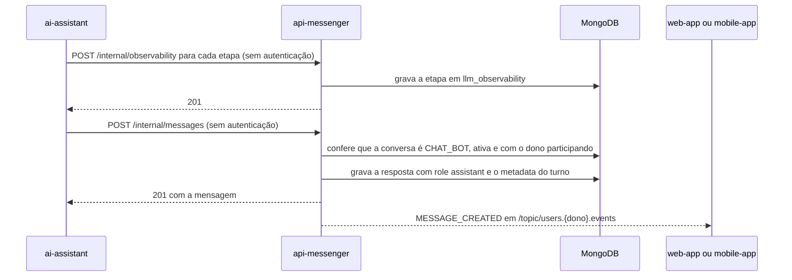

  

# Resposta do assistente

Acontece quando um assistente virtual responde a pessoa. O resultado é a resposta gravada na conversa com o assistente, entregue à pessoa em tempo real, e o registro de cada etapa do pipeline de LLM. O fluxo completo, com roteador e ferramentas, está na [conversa com o assistente](https://github.com/Solierrr/docs-warehouse/blob/main/docs/flows/ASSISTANT_CHAT.md). Este serviço não chama os assistentes. Ele só recebe a gravação.

- A conversa com o assistente é criada pela própria pessoa ou pelo assistente em nome dela, com `userType` e `userDetails`. O campo `userDetails.assistant` diz qual assistente atendeu e aparece no histórico administrativo.
- A resposta grava `CHATBOT_TO_USER`, sem remetente, com o `metadata` (`turnId`, `contentAnonymized`, `specialistsUsed`, `workflowSteps` e `threadTurn`).
- A etapa de LLM é gravada como chega. O serviço não recalcula tokens nem custo e não confere se a conversa existe. Sem `costUsd`, grava 0.0.
- Conversas com o assistente não geram aviso no celular.
- Ao fim da conversa, a pessoa dá a nota de 0 a 10 por `POST /messaging/nps`, uma vez por conversa.

## Histórico administrativo

O painel do `web-sandbox` lê as conversas com o assistente por `GET /messaging/admin/conversations` e o detalhe por `GET /messaging/admin/conversations/{id}`. O detalhe numera os turnos e liga a cada resposta as etapas gravadas desde a resposta anterior. `GET /messaging/admin/langsmith/summary` traz custo, tokens, taxa de erro e latência dos runs do LangSmith por assistente e por modelo. As três rotas exigem um `sub` listado em `DEBUG_ADMIN_SUBS`.

## Erros

- Conversa que não é `CHAT_BOT` dá `400 INVALID_FIELD`, e conversa inexistente dá `404`.
- As falhas de gravação são as mesmas do [envio de mensagem](./SEND_MESSAGE.md#erros).
- Mais de um filtro na busca de etapas dá `400 INVALID_FIELD`.
- NPS em conversa que não é com o assistente dá `422`, e NPS repetido dá `409 DUPLICATE_RESOURCE`.
- Acesso ao histórico administrativo sem estar na lista dá `403 UNAUTHORIZED_ACCESS`, e falha do LangSmith dá `503`.
