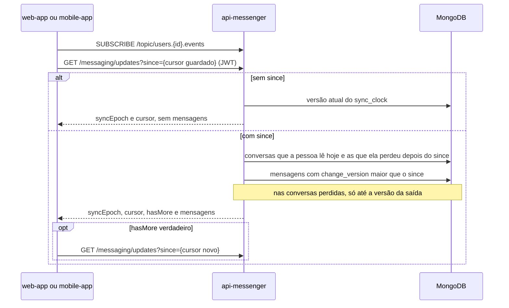

  

# Catch-up depois de reconectar

Acontece quando o aplicativo volta a se conectar e precisa do que perdeu. O resultado é o estado atual de cada mensagem que mudou depois da última versão que o cliente viu, nas conversas que ele lê hoje e nas que perdeu nesse meio-tempo. O `ListMessageUpdatesUseCase` atende `GET /messaging/updates`.

Toda mensagem gravada, editada ou apagada recebe em `change_version` uma versão do relógio `sync_clock`. Quando a pessoa sai de uma conversa, o estado pessoal dela recebe a versão da saída em `left_at_version`. O catch-up compara essas versões com o `since` do cliente.

- O cliente assina o tópico de eventos antes da consulta, para que nada que mude entre as duas coisas se perca. Uma mensagem que chega pelos dois caminhos tem o mesmo `id`.
- A resposta traz o estado atual de cada mensagem, inclusive as apagadas, sem o texto.
- O `cursor` é o `changeVersion` da última mensagem da página. Sem mensagens, ele repete o `since`.
- Um `syncEpoch` diferente do guardado quer dizer que o relógio foi recriado, e o cliente recarrega as conversas do zero.
- A consulta não altera nada.

## Erros

- `since` negativo dá `400 INVALID_FIELD`.
- Sem JWT válido dá `401 UNAUTHENTICATED`.
