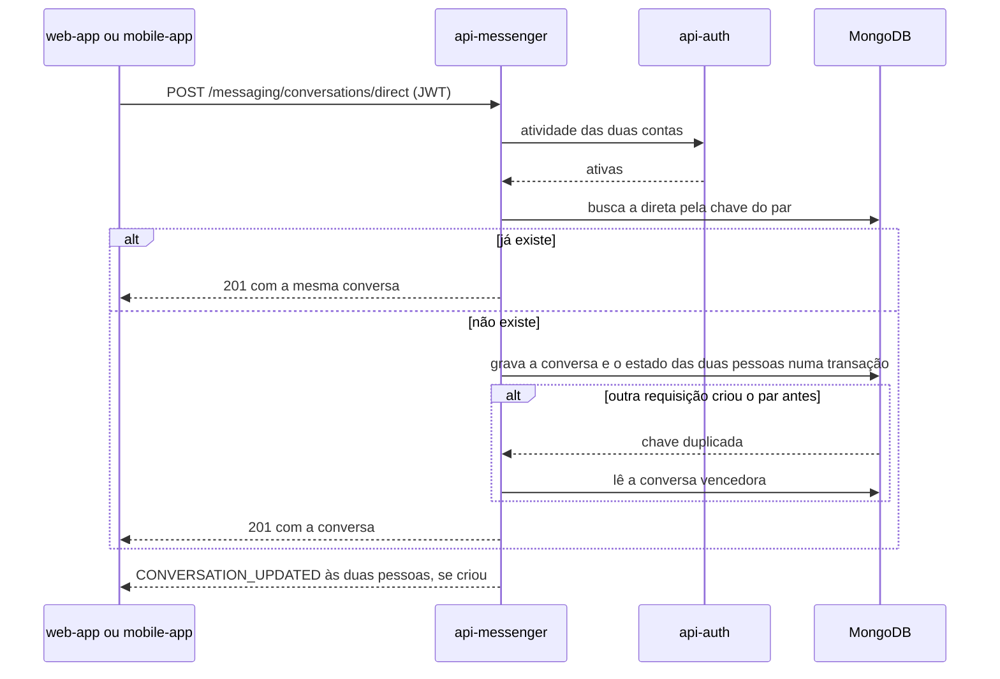

  

# Conversa direta

Acontece quando uma pessoa abre conversa com outra. O resultado é a conversa direta do par, nova ou a mesma de antes. Cada par tem uma conversa direta só, guardada pela chave `direct_key`, que é os dois UUIDs ordenados e unidos por `|`. O `CreateDirectConversationUseCase` faz o fluxo.

## Erros

- Destinatário vazio ou igual a quem pede dá `400 INVALID_FIELD`.
- Conta inexistente dá `404 RESOURCE_NOT_FOUND`, e conta inativa dá `403 UNAUTHORIZED_ACCESS`.
- Conversa encontrada que não corresponde ao par dá `409 DIRECT_IDENTITY_INCONSISTENT`.
- Estado pessoal ausente ou inválido de uma das pessoas dá `422 BUSINESS_RULE_VIOLATION`.
- Falha técnica na criação dá `503 CONVERSATION_PERSISTENCE_UNCERTAIN`.
