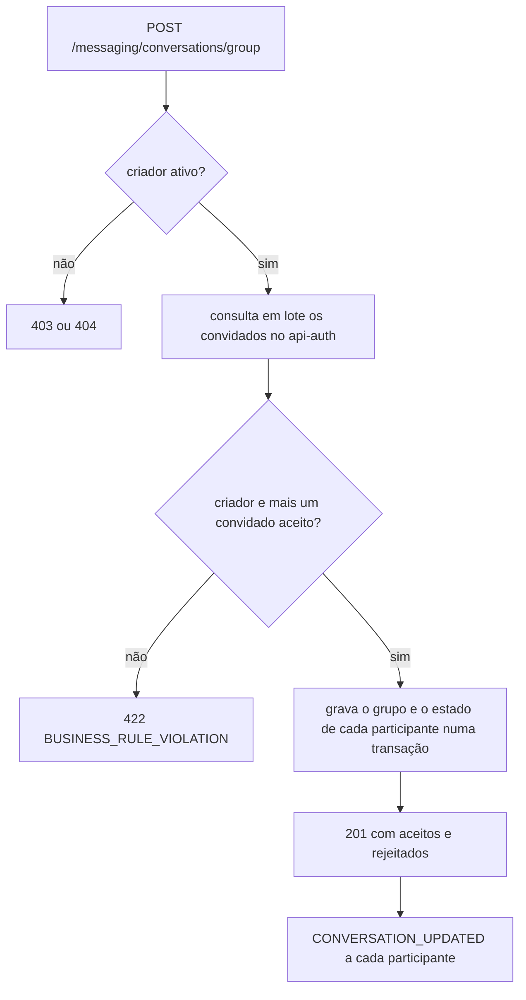
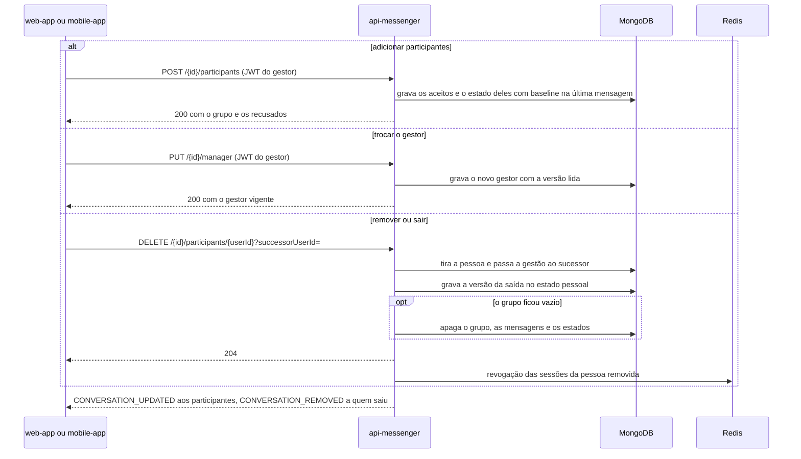

  

# Grupo e gestão de participantes

Acontece quando alguém cria um grupo, adiciona pessoas, troca o gestor ou sai. O resultado é o grupo com os participantes e o gestor atualizados. Os casos de uso são `CreateGroupConversationUseCase`, `AddGroupParticipantsUseCase`, `TransferGroupManagerUseCase` e `RemoveGroupParticipantUseCase`. Toda escrita usa a versão lida do grupo como condição e revalida a permissão na versão mais recente.

## Criar o grupo

Os convidados recusados voltam em `rejectedParticipants` com o motivo `USER_NOT_FOUND`, `USER_INACTIVE` ou, num subgrupo, `NOT_COMMUNITY_MEMBER`, sem dados da conta. O criador vira o gestor.

## Adicionar, trocar o gestor e sair

- Só o gestor de um grupo ativo, com a comunidade ativa quando houver, adiciona, remove outra pessoa e troca o gestor.
- Qualquer participante sai sozinho, mesmo com a comunidade arquivada. O gestor indica um sucessor, a não ser que seja o último participante.
- Num subgrupo, todos os participantes e o sucessor precisam ser membros da comunidade.
- O estado de quem já participou do grupo é reaproveitado na volta.
- Um grupo que fica vazio é apagado de vez, com as mensagens e os estados pessoais.

## Erros

- Operação de gestão em conversa que não é grupo, comunidade arquivada ou nenhum convidado aceito dá `422 BUSINESS_RULE_VIOLATION`.
- Quem não é o gestor dá `403 UNAUTHORIZED_ACCESS`.
- Gestor saindo sem sucessor, com outros participantes no grupo, dá `409 SUCCESSOR_REQUIRED`. Sucessor que não participa, não é membro da comunidade ou está inativo dá `409 SUCCESSOR_INELIGIBLE`.
- Grupo sem gestor válido, ou gestor que já saiu da comunidade tentando sair sozinho, dá `409 GROUP_MANAGER_UNAVAILABLE`.
- Versão alterada por outra operação depois das tentativas dá `409 CONCURRENT_MODIFICATION`.
- Falha técnica na transação de admissão dá `503 ADMISSION_PERSISTENCE_UNCERTAIN`.
