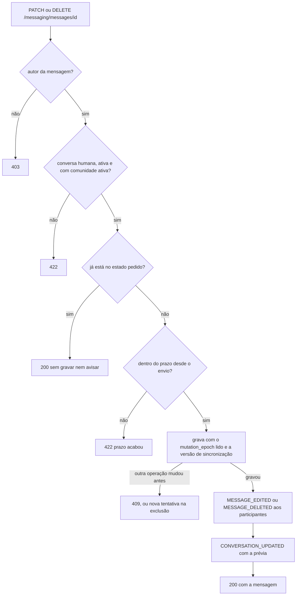

  

# Edição e exclusão de mensagem

Acontece quando o autor edita ou apaga a própria mensagem. O resultado é a mensagem com o texto novo, ou sem texto e marcada como apagada. A edição e a exclusão valem por `MESSAGES_MUTATION_WINDOW` depois do envio, 30 minutos por padrão. O `MessageWriteHelper` grava as duas com o `mutation_epoch` lido como condição.

- A edição grava o texto novo e `edited = true`. A exclusão grava `deleted = true`, remove o texto e não volta atrás.
- Repetir um pedido já aplicado responde 200 mesmo fora do prazo, porque nada muda.
- A exclusão tenta até três vezes quando outra operação muda a mensagem antes. A edição tenta uma vez.
- Cada mudança efetiva recebe um `eventId` novo e um `changeVersion` novo, para o catch-up entregar o estado atual.

## Erros

- Texto vazio, só com espaços ou com mais de 8000 caracteres dá `400`.
- Mensagem inexistente dá `404 RESOURCE_NOT_FOUND`.
- Editar mensagem apagada, conversa com o assistente, comunidade arquivada ou prazo vencido dão `422 BUSINESS_RULE_VIOLATION`.
- A mensagem mudou de conversa durante a operação, ou a escrita perdeu para outra operação, dá `409 CONCURRENT_MODIFICATION`.
- Falha técnica dá `503 MESSAGE_MUTATION_UNCERTAIN`. O cliente consulta a mensagem antes de repetir.
