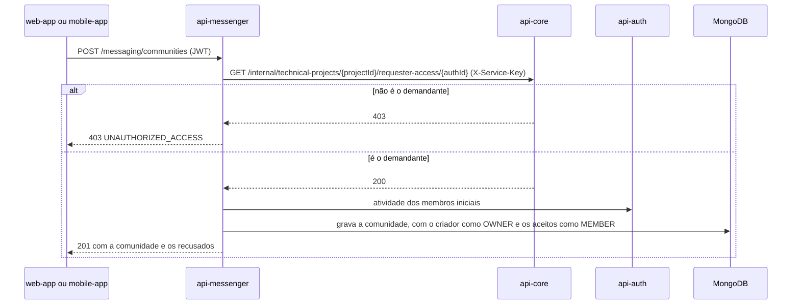
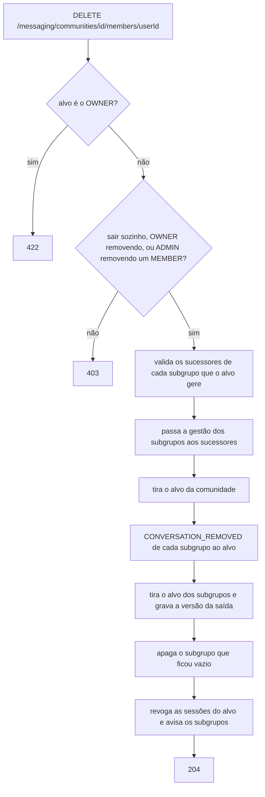

  

# Comunidade de projeto

Acontece quando o demandante de um projeto cria a comunidade e quando os membros entram, mudam de papel ou saem. O resultado é a comunidade com os membros e os subgrupos coerentes entre si. O fluxo central de [comunidade de projeto](https://github.com/Solierrr/docs-warehouse/blob/main/docs/flows/PROJECT_COMMUNITY.md) descreve a comunidade sincronizada com a equipe do projeto no `api-core`. Este serviço faz hoje só a parte abaixo.

## Criar

## Remover um membro ou sair

A remoção passa pelos subgrupos antes de terminar, para que nenhum grupo fique sem gestor. O `RemoveCommunityMemberUseCase` valida o plano inteiro antes de escrever.

O acesso aos subgrupos acaba no passo em que o alvo sai da comunidade, porque a autorização exige ser membro atual. Se uma falha técnica interromper a cascata, o mesmo pedido continua de onde parou.

## Papéis e status

- Adicionar membros e conceder `ADMIN` exigem `OWNER` ou `ADMIN`. Rebaixar ou remover um `ADMIN` exige `OWNER`. `OWNER` nunca é atribuído por pedido.
- Convidados inexistentes ou inativos ficam de fora e voltam em `rejectedParticipants`. Se ninguém puder entrar, a resposta é `422`.
- Arquivar e reativar exigem `OWNER` ou `ADMIN`. Mudar o status avisa todos os subgrupos.
- A comunidade nunca é apagada.
- Quem ainda está em algum subgrupo não volta à comunidade até sair deles.

## Erros

- Projeto ou pessoa inexistente no `api-core` dá `404 RESOURCE_NOT_FOUND`, e o `api-core` fora do ar dá `503 DEPENDENCY_UNAVAILABLE`.
- Projeto que já tem comunidade dá `409 DUPLICATE_RESOURCE`.
- Atribuir `OWNER` dá `400 INVALID_FIELD`.
- Comunidade arquivada em operação de administração, ou nenhum convidado aceito, dá `422 BUSINESS_RULE_VIOLATION`.
- Readmissão com resto em subgrupo dá `409 MEMBERSHIP_CLEANUP_REQUIRED`.
- Sucessor ausente ou inválido dá `409 SUCCESSOR_REQUIRED` ou `409 SUCCESSOR_INELIGIBLE`.
- Falha no meio da cascata dá `503 REMOVAL_INCOMPLETE`.
