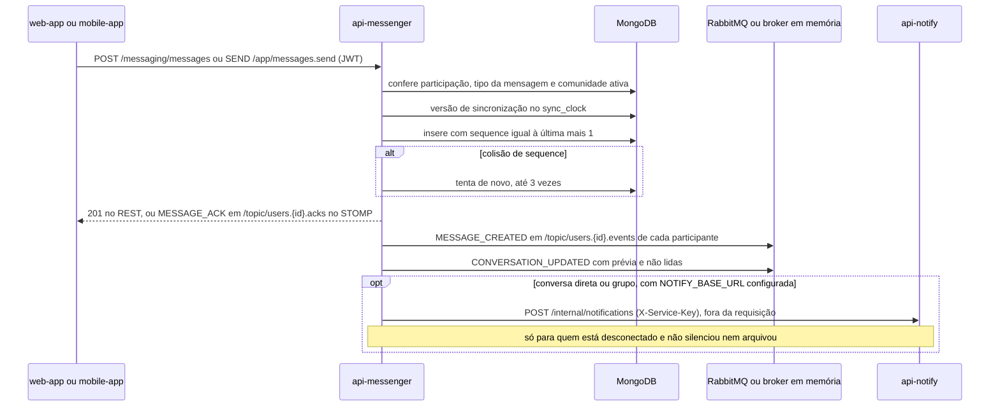

  

# Envio de mensagem

Acontece quando uma pessoa manda mensagem por REST ou pelo WebSocket. O resultado é a mensagem gravada com a próxima `sequence` da conversa, o evento entregue a cada participante e o aviso no celular de quem está desconectado. O `SendUserMessageUseCase` atende os dois transportes.

- O tipo precisa combinar com a conversa. `DIRECT` aceita `USER_TO_USER`, `GROUP` aceita `USER_TO_GROUP` e `CHAT_BOT` aceita `USER_TO_CHATBOT`.
- O servidor define o remetente, o `role` `user` e o horário.
- O `eventId` de `MESSAGE_CREATED` e de `MESSAGE_ACK` é o `id` da mensagem, para o cliente não mostrar a mesma mensagem duas vezes.
- O aviso no celular leva o título "Nova mensagem", ou "Nova mensagem em" seguido do título do grupo, e um trecho de até 100 caracteres. Vai para no máximo 50 pessoas por mensagem.
- Uma falha nos eventos ou no `api-notify` só gera log e não desfaz a mensagem.

## Erros

- Tipo `CHATBOT_TO_USER`, tipo que não combina com a conversa ou `clientMessageId` fora do formato UUID dão `400 INVALID_FIELD`.
- Quem não participa dá `403 UNAUTHORIZED_ACCESS`, e conversa inexistente dá `404`.
- Comunidade arquivada dá `422 BUSINESS_RULE_VIOLATION`.
- Falha ao ler a versão ou a sequência dá `503 DEPENDENCY_UNAVAILABLE`, sem gravar.
- Três colisões de sequência dão `409 CONCURRENT_MODIFICATION`, sem gravar.
- Outra falha dá `503 MESSAGE_PERSISTENCE_UNCERTAIN`. O cliente consulta o histórico antes de reenviar, porque o serviço não descarta mensagens repetidas.
- Os erros de envio levam o `clientMessageId`. No STOMP, eles chegam em `/topic/users.{id}.errors`.
