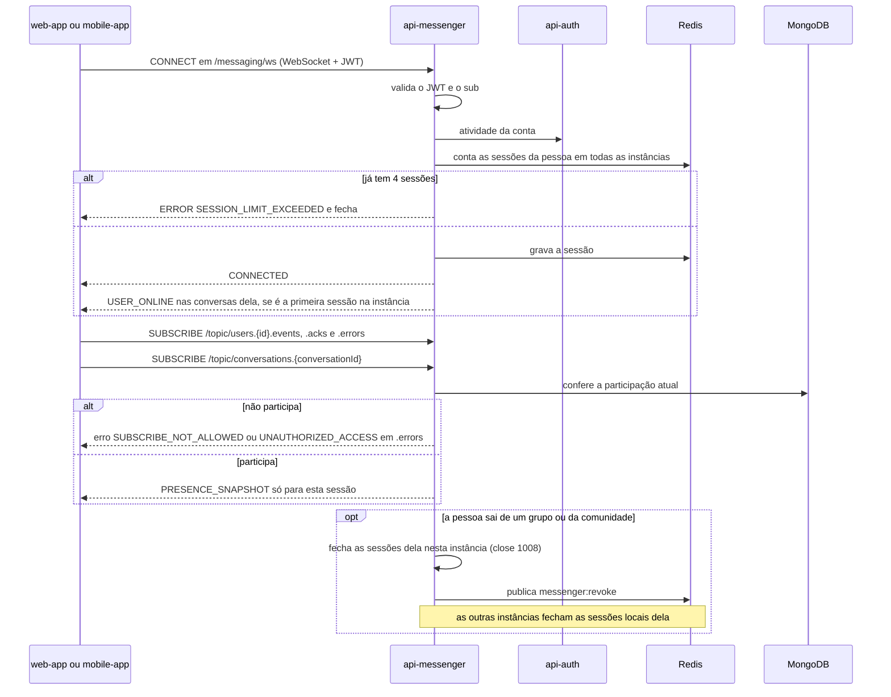

  

# Conexão em tempo real

Acontece quando o aplicativo abre o WebSocket e assina os tópicos. O resultado é uma sessão admitida, a presença da pessoa marcada como conectada e os eventos chegando enquanto ela tiver acesso. O protocolo completo está em [REALTIME.md](../docs/REALTIME.md).

- O primeiro frame precisa chegar em até 10 s.
- A expiração do token é conferida em todo frame, e o token vencido fecha a conexão.
- Uma recusa de `SEND` ou de `SUBSCRIBE` descarta só o frame e não fecha a conexão.
- Cada evento que sai para o cliente passa de novo pela participação atual no Mongo.
- Depois de reconectar, o aplicativo busca o que perdeu pelo [catch-up](./CATCH_UP.md).

## Erros

- Sem `Authorization`, token inválido, `sub` fora do formato UUID, segundo CONNECT na mesma sessão ou conta inativa geram `ERROR` e fecham a sessão.
- A quinta sessão gera `SESSION_LIMIT_EXCEEDED`.
- Destino fora da lista gera `SEND_NOT_ALLOWED` ou `SUBSCRIBE_NOT_ALLOWED`, e comando STOMP fora da lista gera `COMMAND_NOT_ALLOWED`.
- Sem Redis, a presença e o limite de sessões usam só a visão da instância, sem erro para o cliente.
