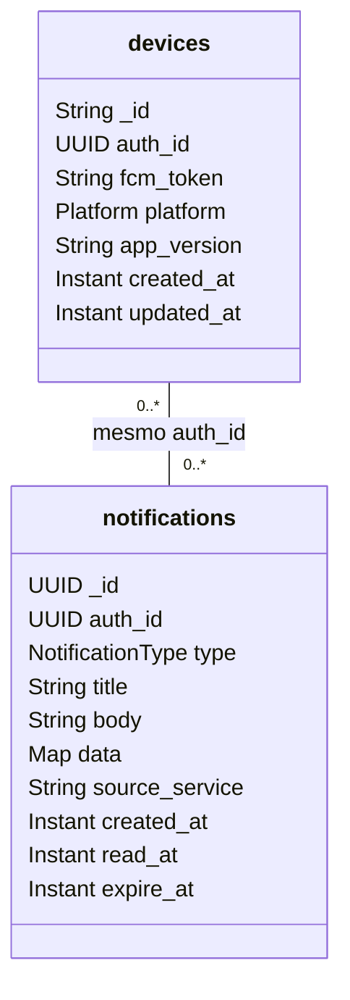

  

# MongoDB

Banco `solaria_notify_db` (nome configurável por `DB_MONGO_NOTIFY`), com duas coleções. Só este serviço lê e escreve nelas.

## `devices`

Um documento por aparelho. O `_id` é o Firebase Installation ID e `platform` é `ANDROID` ou `WEB`. Por isso um aparelho tem no máximo um dono. Cadastrar de novo o mesmo aparelho atualiza o documento em vez de criar outro.

| Índice | Uso |
|---|---|
| `_id` | cadastro e remoção do aparelho |
| `auth_id` | buscar os aparelhos de uma pessoa no envio |

## `notifications`

Um documento por notificação. O `type` é `NEW_MESSAGE`, `SERVICE_SCHEDULED` ou `SERVICE_STATUS_CHANGED`, `source_service` guarda qual serviço pediu o envio, e `read_at` fica nulo até a pessoa ler.

| Índice | Uso |
|---|---|
| `auth_id` e `created_at` decrescente | histórico paginado da pessoa |
| `expire_at` com TTL | o Mongo apaga o documento quando a data passa, 90 dias depois da criação |

Os índices são criados pelo próprio serviço na partida (`spring.data.mongodb.auto-index-creation=true`).
