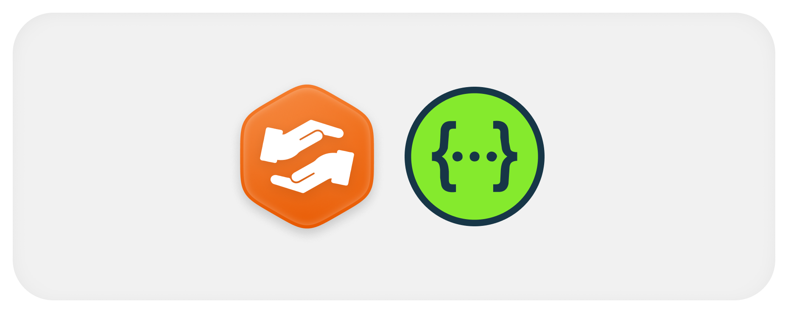

<p align="center">
  
</p>

# API

O contrato completo está no [`openapi.yaml`](https://github.com/Solierrr/api-notify/blob/main/openapi.yaml) do repositório, gerado do código e conferido no CI. Com o serviço no ar, o Swagger fica em `/docs` e o contrato em `/openapi.json`. A rota interna não aparece no Swagger público, só no `openapi.yaml`.

## Autenticação

- As rotas `/notify/**` exigem o JWT de acesso do `api-auth` no cabeçalho `Authorization: Bearer`.
- A rota `/internal/notifications` exige o cabeçalho `X-Service-Key` com a chave do serviço chamador. Hoje são aceitos o `api-messenger` e o `api-core`.

## Grupos de rotas

| Grupo | Rotas | Para que serve |
|---|---|---|
| Aparelhos | `PUT` e `DELETE /notify/devices/{installationId}` | cadastrar, atualizar e remover o aparelho da pessoa |
| Notificações | `GET /notify/notifications`, `GET /notify/notifications/unread-count`, `PATCH /notify/notifications/{id}/read`, `PATCH /notify/notifications/read-all` | histórico, contagem e leitura |
| Interno | `POST /internal/notifications` | outro serviço pede o envio de uma notificação |

## Limites

- O título tem até 120 caracteres e o corpo até 500.
- O campo `data` aceita até 20 entradas, cada valor com até 512 caracteres, e a mensagem inteira precisa caber no limite de 4 KB do Firebase.
- A listagem devolve no máximo 100 itens por página. Um tamanho maior é reduzido para 100, sem erro.

## Erros

Os erros seguem o [contrato de erro](https://github.com/Solierrr/docs-warehouse/blob/main/docs/standards/ERRORS.md) e usam só códigos genéricos do [catálogo](https://github.com/Solierrr/docs-warehouse/blob/main/docs/standards/ERROR_CODES.md), como `UNAUTHENTICATED`, `FORBIDDEN`, `NOT_FOUND` e `VALIDATION_FAILED`.

## Exemplo

Pedido de envio feito por outro serviço.

```http
POST /internal/notifications
X-Service-Key: <chave do serviço chamador>
Content-Type: application/json

{
  "authId": "7b0c5f2e-3d6a-4c51-9a2f-1d8e4b7c9a10",
  "type": "NEW_MESSAGE",
  "title": "Nova mensagem",
  "body": "Você recebeu uma mensagem na comunidade do projeto",
  "data": { "conversationId": "c-1029" }
}
```

A resposta é `201` com o identificador da notificação e quantos aparelhos receberam, falharam ou foram removidos por token inválido.
