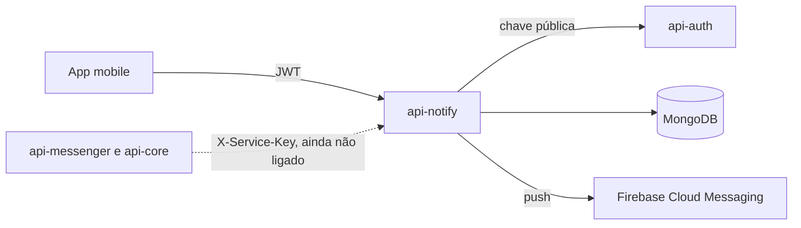

  

# Arquitetura

Serviço Spring Boot 4 em Java 21, com MongoDB e envio de push pelo Firebase Cloud Messaging. Tem duas portas de entrada. As rotas `/notify/**` atendem a pessoa, com o JWT do `api-auth`, e a rota `/internal/notifications` atende outros serviços, com `X-Service-Key`.

## Pastas

| Pasta em `src/main/java/com/solaria/notify/` | Papel |
|---|---|
| `controller/` | rotas HTTP, uma classe por recurso |
| `openapi/` | interfaces com as anotações do Swagger, separadas dos controllers |
| `service/` | regras de negócio (`NotificationService`, `DeviceService`) |
| `repository/` | acesso ao Mongo |
| `model/` | documentos do Mongo e enums |
| `dto/` | entrada e saída das rotas, com as validações |
| `push/` | envio de push atrás da interface `PushSender` |
| `security/` | JWT, chave de serviço e respostas de erro de autenticação |
| `exception/` | erros de negócio e o tratamento global em `ProblemDetail` |
| `observability/` | OpenTelemetry, health checks e `traceId` na resposta |
| `config/` | Swagger, Mongo e relógio |

## Integrações

| Com quem | Direção | Protocolo | Autenticação |
|---|---|---|---|
| App mobile | chama este serviço | HTTP REST | JWT do `api-auth` |
| `api-messenger`, `api-core` | vão chamar este serviço (ainda não ligado) | HTTP REST em `/internal/notifications` | `X-Service-Key`, aceitos `SERVICE_KEY_API_MESSENGER` e `SERVICE_KEY_API_CORE` |
| `api-auth` | este serviço lê | HTTP, chave pública em `/.well-known/jwks.json` | nenhuma |
| Firebase Cloud Messaging | este serviço chama | HTTP v1 | credencial de conta de serviço (`FCM_CREDENTIALS_BASE64`) |

Os fluxos estão em [`flows/`](../flows/), e o padrão de chamada entre serviços em [SERVICE_TO_SERVICE_AUTH.md](https://github.com/Solierrr/docs-warehouse/blob/main/docs/flows/SERVICE_TO_SERVICE_AUTH.md).

## Dados

Duas coleções no MongoDB, `devices` e `notifications`, descritas em [MONGO.md](../database/MONGO.md).

## Decisões técnicas

- O envio de push fica atrás de uma interface. O `PushSender` tem duas implementações. A `LoggingPushSender` é a padrão e só registra o envio no log, para rodar local e no QA sem credencial do Firebase. A `FcmPushSender` entra com `FCM_ENABLED=true`.
- A notificação é salva antes do push, e uma falha no envio nunca desfaz a gravação. O histórico é a fonte da verdade, e o push é só o aviso.
- Quando o Firebase diz que um token não vale mais, o aparelho é removido, mas só se o token gravado ainda for o mesmo. Isso evita apagar um aparelho que foi recadastrado durante o envio.
- A retenção usa um índice TTL. O campo `expire_at` recebe a data de criação mais 90 dias, e o próprio Mongo apaga o documento. Não há job de limpeza.
- Notificação ou aparelho de outra pessoa responde 404, como se não existisse, para não revelar dados.
- O aparelho é identificado pelo Firebase Installation ID, estável entre reinstalações do token, e não pelo token FCM, que muda.

## Erros, health e versão

- Todo erro sai em `application/problem+json`, no [contrato de erro](https://github.com/Solierrr/docs-warehouse/blob/main/docs/standards/ERRORS.md).
- O pronto (`/actuator/health/readiness`) confere o Mongo com um `ping` só no banco do serviço, pelo `MongoPingHealthIndicator`. O indicador padrão do Spring Boot não funciona com o usuário do Atlas.
- A versão vem do `pom.xml`, atualizado pelo release-please, e aparece em `/actuator/info` e no Swagger.
