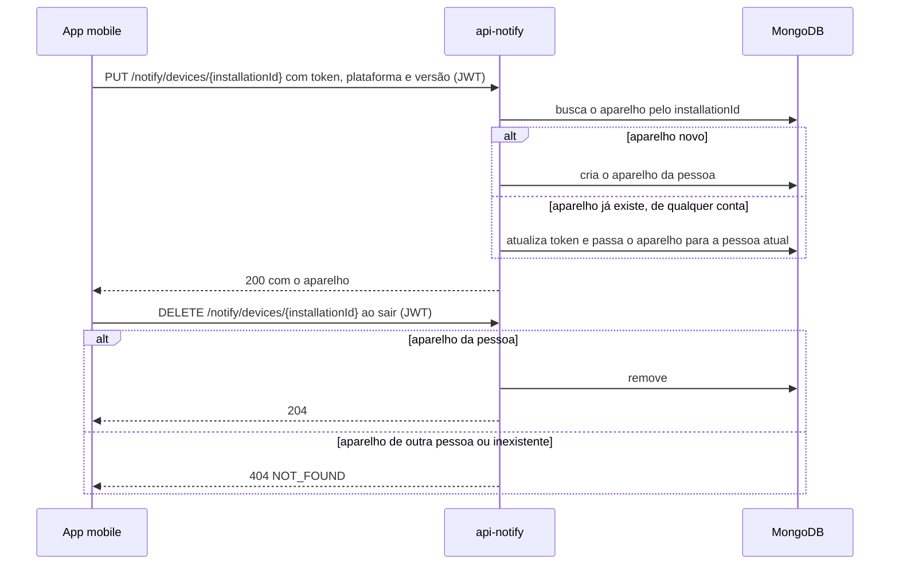

  

# Cadastro de aparelho

Acontece quando a pessoa entra no aplicativo e quando o Firebase troca o token do aparelho. O resultado é o aparelho ligado à conta dela e pronto para receber avisos. Ao sair da conta, o aplicativo remove o aparelho.

## Erros

- Sem JWT ou com JWT inválido, a resposta é `401 UNAUTHENTICATED`.
- Token, plataforma ou versão fora do formato dão `422 VALIDATION_FAILED`.
