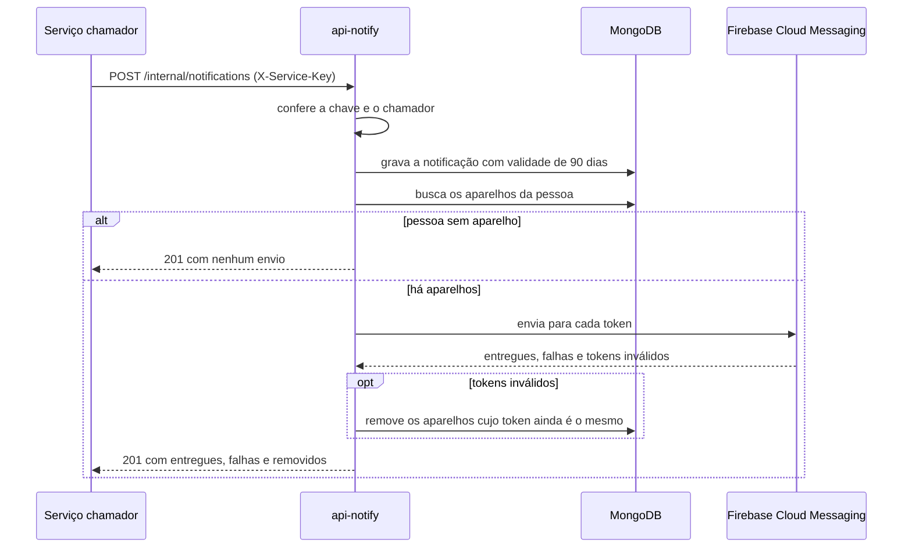

  

# Envio de notificação

Acontece quando outro serviço decide avisar uma pessoa. O resultado é a notificação gravada no histórico e o aviso entregue em cada aparelho dela. A gravação vem antes do envio e nunca é desfeita por falha no push.

O pedido entre serviços segue o fluxo central de [chamada entre serviços](https://github.com/Solierrr/docs-warehouse/blob/main/docs/flows/SERVICE_TO_SERVICE_AUTH.md).

## Erros

- Chave ausente ou desconhecida dá `401 UNAUTHENTICATED`, e chamador não aceito dá `403 FORBIDDEN`.
- Campos fora dos limites dão `422 VALIDATION_FAILED`.
- Falha no Firebase não gera erro para o chamador. A notificação fica gravada e a resposta informa as falhas.
