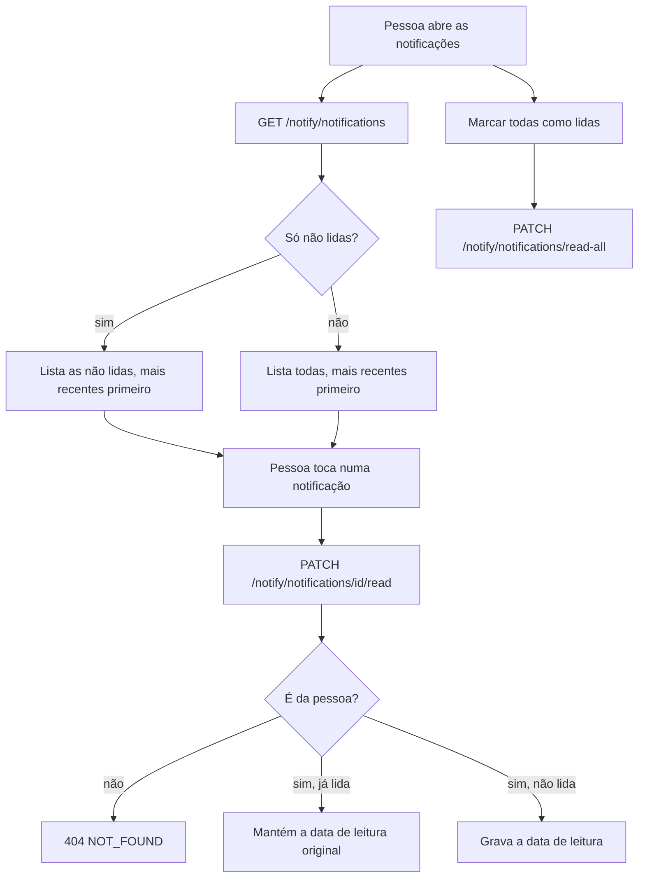

  

# Leitura das notificações

Acontece quando a pessoa abre a lista de notificações no aplicativo. O resultado é o histórico exibido e as notificações marcadas como lidas.

O ícone de não lidas usa `GET /notify/notifications/unread-count`.
