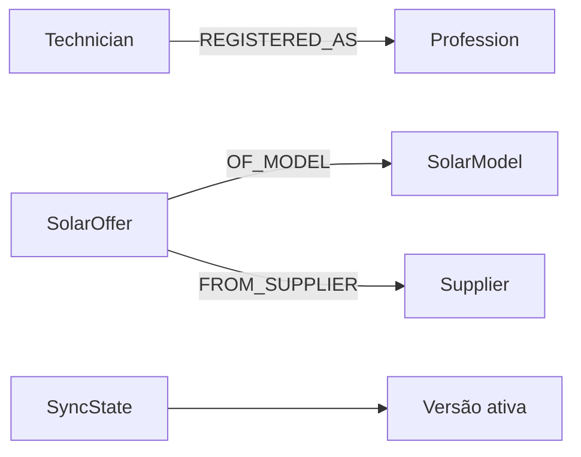

  

# Projeção de recomendações

O serviço apenas lê o grafo, que é produzido e reconstruído pelo `database-bootstrap`, como descreve o [fluxo de recomendações](https://github.com/Solierrr/docs-warehouse/blob/main/docs/flows/RECOMMENDATION_FEED.md), e as [consultas](https://github.com/Solierrr/api-recommendation/tree/main/app/feeds) sempre filtram por `source` e `sync_version`.

O `Technician` fornece o identificador, o nome, o usuário ativo, as avaliações e as contagens globais de serviços, e a relação `REGISTERED_AS` fornece as certificações válidas e os seus nomes. O `SolarOffer` traz o preço em centavos, a disponibilidade, o vencimento e a quantidade em propostas aceitas, o `SolarModel` traz a aprovação, a marca, o modelo, a potência, a eficiência, as dimensões e o peso, e o `Supplier` traz a identificação, a situação, a assinatura, a localização e o nome comercial, enquanto o `SyncState` seleciona o snapshot ativo.

Os índices e as constraints pertencem ao produtor do grafo e não são criados por esta API, que consulta o PostgreSQL apenas como fonte alternativa e não tem migrations de dados próprias.