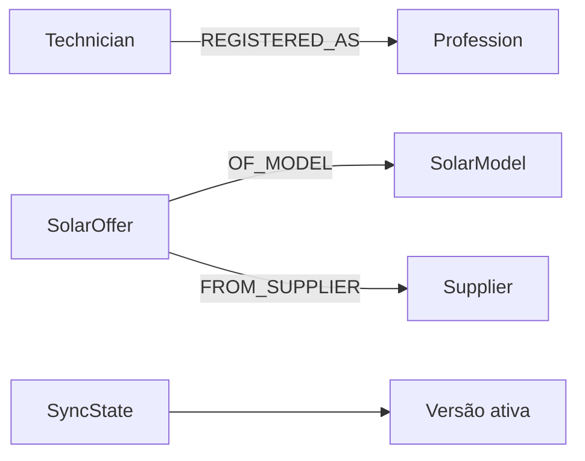

  

# Projeção de recomendações

O serviço somente lê o grafo. O produtor e dono da reconstrução é o `database-bootstrap`, conforme o [fluxo de recomendações](https://github.com/Solierrr/docs-warehouse/blob/main/docs/flows/RECOMMENDATION_FEED.md). As [consultas](https://github.com/Solierrr/api-recommendation/tree/main/app/feeds) filtram `source` e `sync_version`.

`Technician` fornece identificador, nome, usuário ativo, avaliações e contagens globais de serviços. `REGISTERED_AS` fornece certificações válidas e seus nomes. `SolarOffer` fornece preço em centavos, disponibilidade, vencimento e quantidade em propostas aceitas. `SolarModel` fornece aprovação, marca, modelo, potência, eficiência, dimensão e peso. `Supplier` fornece identificação, situação, assinatura, localização e nome comercial. `SyncState` seleciona o snapshot ativo.

Índices e constraints pertencem ao produtor e não são criados por esta API. PostgreSQL é consultado somente como fonte alternativa. Não há migrations de dados próprias nesta aplicação.
