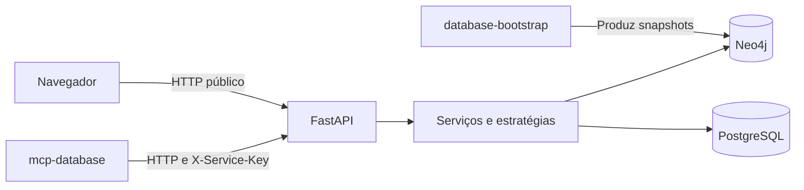

  

# Arquitetura

A aplicação FastAPI separa rotas, schemas, estratégias e consultas por domínio em `app/feeds/`. O [código comum](https://github.com/Solierrr/api-recommendation/blob/main/app/feeds/common.py) limita candidatos e faz fallback apenas quando recebe `GraphUnavailableError`.

| Integração | Acesso |
|---|---|
| `mcp-database` | `/feeds/*` com `X-Service-Key` |
| Navegador | `/public/feeds/*`, sem chave e com CORS configurável |
| Neo4j | Leitura Bolt pelo driver, credenciais de banco |
| PostgreSQL | Leitura SQL, credenciais e modo SSL configuráveis |

Os clientes de dados ficam em `app/database.py` e as consultas Cypher e SQL ficam junto dos domínios, com o snapshot escolhido por `SyncState.active_version`. A alternativa sem grafo não vale para toda exceção de negócio, porque um contexto inválido precisa ser informado ao chamador.

O `/health` informa a versão lida de `version.txt`, e o `/ready` testa somente o PostgreSQL, com limite de dois segundos, de modo que a ausência do grafo não tira o serviço da prontidão. O modelo consumido está em [NEO4J.md](../database/NEO4J.md).