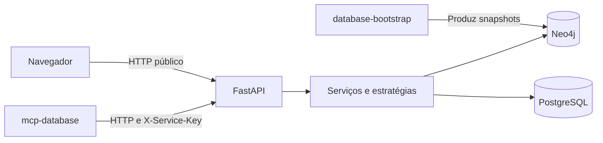

  

# Arquitetura

A aplicação FastAPI separa rotas, schemas, estratégias e consultas por domínio em `app/feeds/`. O [código comum](https://github.com/Solierrr/api-recommendation/blob/main/app/feeds/common.py) limita candidatos e faz fallback apenas quando recebe `GraphUnavailableError`.

| Integração | Acesso |
|---|---|
| `mcp-database` | `/feeds/*` com `X-Service-Key` |
| Navegador | `/public/feeds/*`, sem chave e com CORS configurável |
| Neo4j | Leitura Bolt pelo driver, credenciais de banco |
| PostgreSQL | Leitura SQL, credenciais e modo SSL configuráveis |

Os clientes de dados estão em `app/database.py`. Consultas Cypher e SQL ficam junto dos domínios. O snapshot usa `SyncState.active_version`. Não se aplica fallback para toda exceção de negócio, pois contexto inválido deve ser informado ao chamador.

O `/health` informa versão de `version.txt`. O `/ready` testa somente PostgreSQL, com timeout de dois segundos. A ausência do grafo não tira o serviço de prontidão. O modelo consumido está em [NEO4J.md](../database/NEO4J.md).
