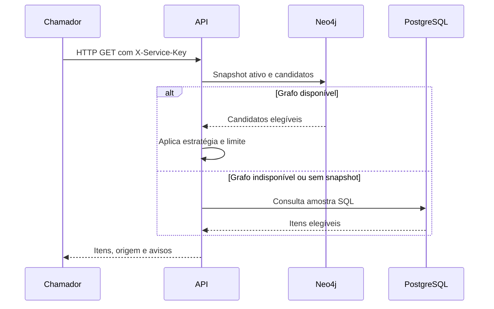

  

# Consulta de recomendações

O feed de `offers` classifica os candidatos por preço por Wp, eficiência, distância ou adoção comercial. O [fluxo central](https://github.com/Solierrr/docs-warehouse/blob/main/docs/flows/RECOMMENDATION_FEED.md) descreve a produção do snapshot.

Chave ausente ou inválida produz 401. Contexto inexistente produz 404, e contexto insuficiente ou conjunto acima do limite produz 422. Indisponibilidade das fontes necessárias produz 503. A rota pública usa somente PostgreSQL, sem chave ou etapa de ranking do grafo.
