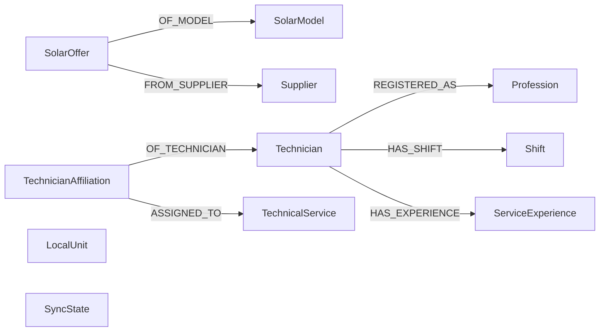

  

# Grafo de recomendações

O grafo é uma projeção reconstruível do cadastro de negócio. Há dez labels de domínio e um label de controle. A rotina lê PostgreSQL e escreve Neo4j. O serviço de recomendação é o leitor previsto.

## Relações

`LocalUnit` não recebe relação própria nos arquivos atuais. `TechnicalService.local_unit_id` é referência por propriedade. `ASSIGNED_TO` guarda `executor_id` e função. `REGISTERED_AS` guarda contagem e nomes de certificações válidas. Todas as relações recebem fonte e versão.

## Propriedades dos nós

| Label | Propriedades gravadas |
|---|---|
| `TechnicianAffiliation` | `graph_key`, `id`, `affiliation_type`, `active`, `company_id`, `company_trade_name`, `company_geolocation_count`, `company_latitude`, `company_longitude`, `source`, `sync_version` |
| `LocalUnit` | `graph_key`, `id`, `location_type`, `complement`, `geolocation_count`, `latitude`, `longitude`, `source`, `sync_version` |
| `Profession` | `graph_key`, `id`, `name`, `requires_registration`, `accept_emergency_call`, `source`, `sync_version` |
| `ServiceExperience` | `graph_key`, `technician_id`, `normalized_purpose`, `completed_count`, `source`, `sync_version` |
| `Shift` | `graph_key`, `id`, `day_week`, `start_at`, `end_at`, `source`, `sync_version` |
| `SolarModel` | `graph_key`, `id`, `brand`, `model`, `power_wp`, `efficiency`, `dimension`, `weight`, `status`, `source`, `sync_version` |
| `SolarOffer` | `graph_key`, `id`, `unit_price_cents`, `availability`, `inventory_quantity`, `effective_availability`, `expiration_at`, `accepted_proposal_quantity`, `source`, `sync_version` |
| `Supplier` | `graph_key`, `id`, `status`, `business_type`, `company_id`, `trade_name`, `subscription_active`, `geolocation_count`, `latitude`, `longitude`, `source`, `sync_version` |
| `TechnicalService` | `graph_key`, `id`, `purpose`, `normalized_purpose`, `status`, `scheduled_at`, `created_at`, `end_at`, `project_id`, `local_unit_id`, `geolocation_count`, `latitude`, `longitude`, `source`, `sync_version` |
| `Technician` | `graph_key`, `id`, `name`, `crea`, `user_active`, `average_rating_global`, `review_count_global`, `assigned_service_count_global`, `completed_service_count_global`, `canceled_service_count_global`, `active_workload`, `source`, `sync_version` |

`SyncState` guarda `source`, `active_version`, `previous_version`, `sync_in_progress`, `lock_token`, `lock_fence`, datas de lock e ativação e `pending_cleanup_versions`. Alguns campos só existem após a etapa correspondente. Não se trata de histórico completo de execuções.

## Identidade e índices

Cada nó de domínio tem constraint única de `graph_key`. São dez constraints mais uma de `SyncState.source`. A chave de domínio inclui fonte, versão e id. Experiência usa técnico e propósito normalizado. Isso separa versões mesmo quando o id operacional é igual.

Há cinco índices explícitos além dos de unicidade. `LocalUnit`, `Profession` e `TechnicalService` indexam fonte, versão e id. `SolarOffer` indexa fonte e versão. `TechnicianAffiliation` indexa fonte, versão e atividade.

MERGE por chave não implica que o número retornado por estágio seja quantidade de nós distintos. O estágio de modelo ou fornecedor pode receber várias ofertas da mesma entidade e processar todas as linhas.

## Extração e ciclo

São dez datasets, de unidades, ofertas, profissões, técnicos, registros, vínculos, turnos, serviços, experiência e atribuições. Apenas profissionais aprovados ligados a conta ativa alimentam os datasets dependentes de elegibilidade. Geolocalização só publica coordenadas quando há exatamente um registro correspondente.

Oferta elegível exige fornecedor ativo, assinatura paga vigente, modelo aprovado, preço e disponibilidade positivos, estoque e medidas físicas válidas. O extrator converte preço para centavos e dimensão para largura vezes comprimento. Os nomes antigos usados no SQL precisam de alinhamento com a origem atual. <!-- PENDENTE: 1 -->

A ativa e a anterior são preservadas. Falha prévia à ativação tenta remover o staging. Versões órfãs são registradas para limpeza posterior, sempre protegendo ativa e anterior. Não há TTL automático do banco. A seleção da versão correta pelo leitor precisa ser confirmada na implantação. <!-- PENDENTE: 3 -->

Fontes em [schema](https://github.com/Solierrr/database-bootstrap/blob/main/src/graphs/schema.cypher), [nós](https://github.com/Solierrr/database-bootstrap/tree/main/src/graphs/nodes), [relações](https://github.com/Solierrr/database-bootstrap/tree/main/src/graphs/relationships) e [extração](https://github.com/Solierrr/database-bootstrap/blob/main/src/extract.sql).
