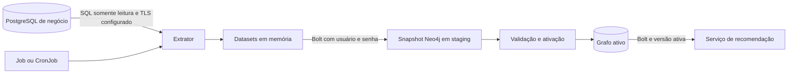

  

# Arquitetura

Job Python 3.14 que lê PostgreSQL por psycopg e grava Neo4j por Bolt. O Python descobre datasets e estágios a partir de SQL e Cypher, sem definir as regras de elegibilidade no orquestrador.

## Componentes

| Caminho | Papel |
|---|---|
| `src/main.py` | Configuração, extração, lotes e códigos de saída |
| `src/config.json` | Variáveis, padrões, limites e timeouts |
| `src/extract.sql` | Dez datasets e fragmentos reutilizados |
| `src/graphs/schema.cypher` | Constraints e índices |
| `src/graphs/nodes/` | Dez projeções de nós de domínio |
| `src/graphs/relationships/` | Sete tipos de relação |
| `src/graphs/snapshot/` | Lock, validação, ativação e limpeza |

## Protocolo e dados

PostgreSQL e Neo4j recebem credenciais do ambiente. Não há autenticação JWT, chave de serviço ou endpoint HTTP próprio. O contexto integrado está em [feed de recomendações](https://github.com/Solierrr/docs-warehouse/blob/main/docs/flows/RECOMMENDATION_FEED.md).

A conexão PostgreSQL usa REPEATABLE READ e somente leitura. O extrator acumula os dez datasets em memória com fetchall antes de gravar o grafo. `SYNC_BATCH_SIZE` limita o envio ao Neo4j, sem limitar a memória da extração.

As queries ainda usam `users` e colunas `fk_*`, enquanto a main atual do cadastro passou a nomes como `user_account` e referências terminadas em `_id`. O job não executa migração nem adapta esses nomes. <!-- PENDENTE: 1 -->

O modelo está em [NEO4J.md](../database/NEO4J.md). `graph_key` inclui fonte e versão, permitindo staging sem alterar nós da versão ativa. Cada execução recebe UUID próprio.

## Consistência

O schema é aplicado antes do lock. O lock em `SyncState` tem lease e token da execução. Ele é renovado após datasets e lotes, sem heartbeat durante uma consulta longa. Perder a posse impede a ativação pelo caminho protegido.

Cada estágio devolve quantidade de linhas processadas. Ela deve coincidir com o dataset enviado, inclusive quando múltiplas linhas convergem no mesmo nó por MERGE. Isso detecta relações sem ponta, sem equivaler a contar nós únicos.

A validação compara labels e tipos de relação por volume, não o conteúdo completo. Domínio sem registros na versão ativa não estabelece um mínimo inicial. A política operacional precisa distinguir queda legítima de extração incompleta. <!-- PENDENTE: 2 -->

A ativação troca `active_version` e registra a anterior. Se a resposta se perde, o código tenta reconciliar a troca antes de abortar. Limpeza e liberação são best effort e podem deixar pendências recuperadas na próxima execução. O consumidor precisa respeitar o ponteiro ativo. <!-- PENDENTE: 3 -->

## Observabilidade e versão

Logs registram versão, contagens e falhas. Saúde é o resultado do processo e dos Jobs, sem rota de health. A imagem usa Python 3.14-slim e usuário sem privilégio. O workflow publica imagem na main.

A main analisada é `0d39bf86`, em 2026-10-30. Fontes em [orquestrador](https://github.com/Solierrr/database-bootstrap/blob/main/src/main.py), [extração](https://github.com/Solierrr/database-bootstrap/blob/main/src/extract.sql), [configuração](https://github.com/Solierrr/database-bootstrap/blob/main/src/config.json) e [ativação](https://github.com/Solierrr/database-bootstrap/blob/main/src/graphs/snapshot/activate_snapshot.cypher).
