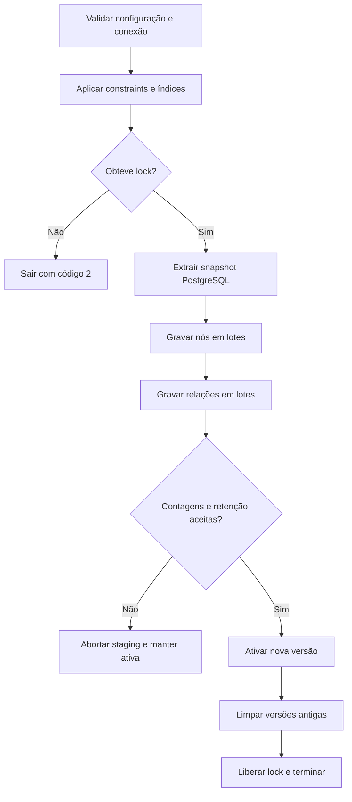

  

# Construção e ativação

O job cria um snapshot sem alterar a versão ativa até a validação terminar.

## Falhas e limites

Configuração ausente sai 64. Contagens divergentes, queda anormal ou perda da posse saem 3. Exceção inesperada sai 1. Extração ou estágio falho conserva a ativa. O leitor deve usar o ponteiro, não todos os nós.

Fonte em [implementação](https://github.com/Solierrr/database-bootstrap/blob/main/src/main.py). O contexto está em [feed de recomendações](https://github.com/Solierrr/docs-warehouse/blob/main/docs/flows/RECOMMENDATION_FEED.md).
