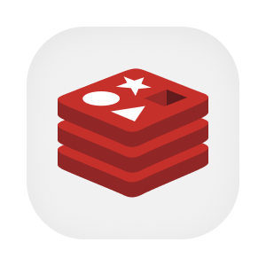

  

  
  

# Operações de dados

Este repositório reúne as operações de apoio aos dados da plataforma. A equipe pode preparar um ambiente local, carregar dados de desenvolvimento, conferir permissões e produzir cópias de segurança. Os dados de identidade e de negócio continuam sob responsabilidade dos serviços que os mantêm, enquanto o destino de indicadores possui uma configuração própria aqui.

Os utilitários usam Python, clientes PostgreSQL e scripts de sistema. Uma composição Docker fornece PostgreSQL e Redis no desenvolvimento. As credenciais são obtidas pelo Infisical. O destino de indicadores recebe resultados calculados no Databricks, com acesso por login e escopo, e não serve de origem para calcular esses indicadores.

## Aprofunde-se no Projeto!

- [OVERVIEW.md](./docs/OVERVIEW.md), finalidade e regras de produto.
- [ARCHITECTURE.md](./docs/ARCHITECTURE.md), componentes, dados e integrações.
- [RUNNING.md](./docs/RUNNING.md), preparação e execução local.
- [DEPLOY.md](./docs/DEPLOY.md), ambientes e publicação.
- [STATUS.md](./docs/STATUS.md), limites observados.
- [DATABASES.md](./docs/DATABASES.md), detalhes do fluxo ou modelo de dados.
- [SECRETS_AND_BACKUP.md](./docs/SECRETS_AND_BACKUP.md), detalhes do fluxo ou modelo de dados.
- [POSTGRES.md](./database/POSTGRES.md), detalhes do fluxo ou modelo de dados.
- [MIGRATION.md](./flows/MIGRATION.md), detalhes do fluxo ou modelo de dados.
- [SEED.md](./flows/SEED.md), detalhes do fluxo ou modelo de dados.
- [BACKUP.md](./flows/BACKUP.md), detalhes do fluxo ou modelo de dados.
- [PENDENCIAS.md](./PENDENCIAS.md), questões para revisão.

## Contribuindo

- [CONTRIBUTING.md](https://github.com/Solierrr/.github/blob/main/.github/CONTRIBUTING.md), convenções de contribuição.
- [CODE_OF_CONDUCT.md](https://github.com/Solierrr/.github/blob/main/CODE_OF_CONDUCT.md), código de conduta.
- [SECURITY.md](https://github.com/Solierrr/.github/blob/main/SECURITY.md), relato de vulnerabilidades.
