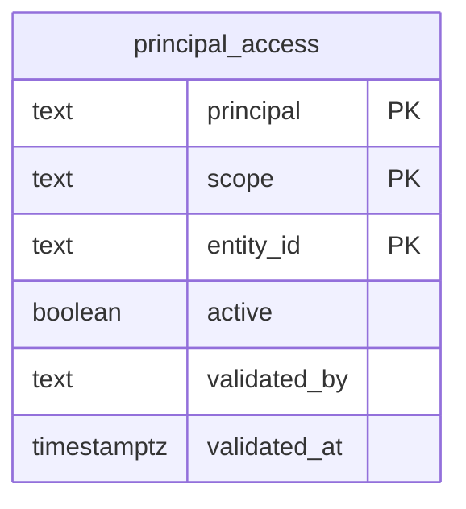

  

# PostgreSQL e autorização analítica

`coredb` pertence ao `api-core` e `authdb` ao `api-auth`. Seus relacionamentos são documentados pelos donos. O schema criado aqui é `gold`, em analytics.

A chave composta identifica login, escopo e entidade. Os escopos aceitos são `ADMIN`, `EXPORTER`, `SUPPLIER`, `REQUESTER` e `PROFESSIONAL`. O registro começa vazio e não é público. A função `gold.can_read` usa `session_user`, mesmo como `SECURITY DEFINER`, e autoriza o proprietário da função, administradores, exportadores ou o login associado a uma única entidade ativa no escopo consultado.

As tabelas KPI e suas políticas RLS são criadas pelo exportador, a partir do contrato de views Gold. Uma alteração de estrutura exige migração revisada. O schema local não antecipa as colunas dessas tabelas. A fonte é [schema.sql](https://github.com/Solierrr/database-console/blob/main/db/analytics/schema.sql).
