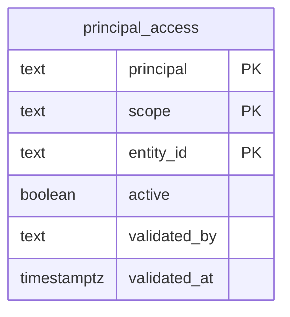

  

# PostgreSQL e autorização analítica

O `coredb` pertence ao `api-core` e o `authdb` ao `api-auth`, e os relacionamentos de cada um são documentados pelos donos, enquanto o schema criado aqui é o `gold`, no banco de analytics.

A chave composta identifica login, escopo e entidade. Os escopos aceitos são `ADMIN`, `EXPORTER`, `SUPPLIER`, `REQUESTER` e `PROFESSIONAL`. O registro começa vazio e não é público. A função `gold.can_read` usa `session_user`, mesmo como `SECURITY DEFINER`, e autoriza o proprietário da função, administradores, exportadores ou o login associado a uma única entidade ativa no escopo consultado.

As tabelas de KPI e as suas políticas de RLS são criadas pelo exportador a partir do contrato das views Gold, e o schema local não antecipa as colunas dessas tabelas, por isso uma mudança de estrutura exige uma migração revisada. A fonte é o [schema.sql](https://github.com/Solierrr/database-console/blob/main/db/analytics/schema.sql).