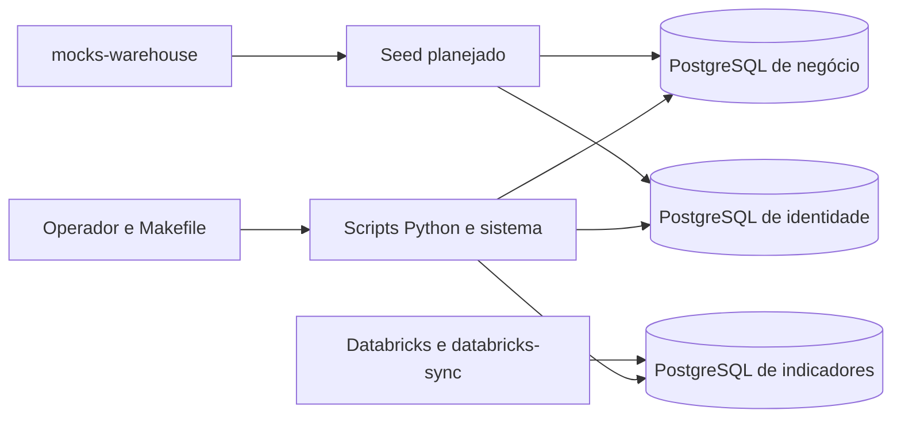

  

# Arquitetura

O repositório contém scripts operacionais, seed e DDL de analytics. O schema de negócio pertence ao Flyway do `api-core`, e o de identidade ao Flyway do `api-auth`, diferentemente do checklist antigo.

| Pasta | Papel |
|---|---|
| `seed/` | Plano, construção, imagens e carga determinística |
| `scripts/` | Papéis de acesso, carga volumétrica, backup e stack local |
| `db/roles/` | Contrato de privilégios por consumidor |
| `db/analytics/` | Schema de indicadores e autorização |
| `docker/` | Criação inicial dos bancos locais |

As conexões PostgreSQL usam credenciais do ambiente. O backup usa `pg_dump`. A stack local inicia as APIs para que seus Flyway criem as estruturas. O mapa de bancos está em [POSTGRES.md](../database/POSTGRES.md) e o fluxo analítico em [ANALYTICS_SYNC.md](https://github.com/Solierrr/docs-warehouse/blob/main/docs/flows/ANALYTICS_SYNC.md).
