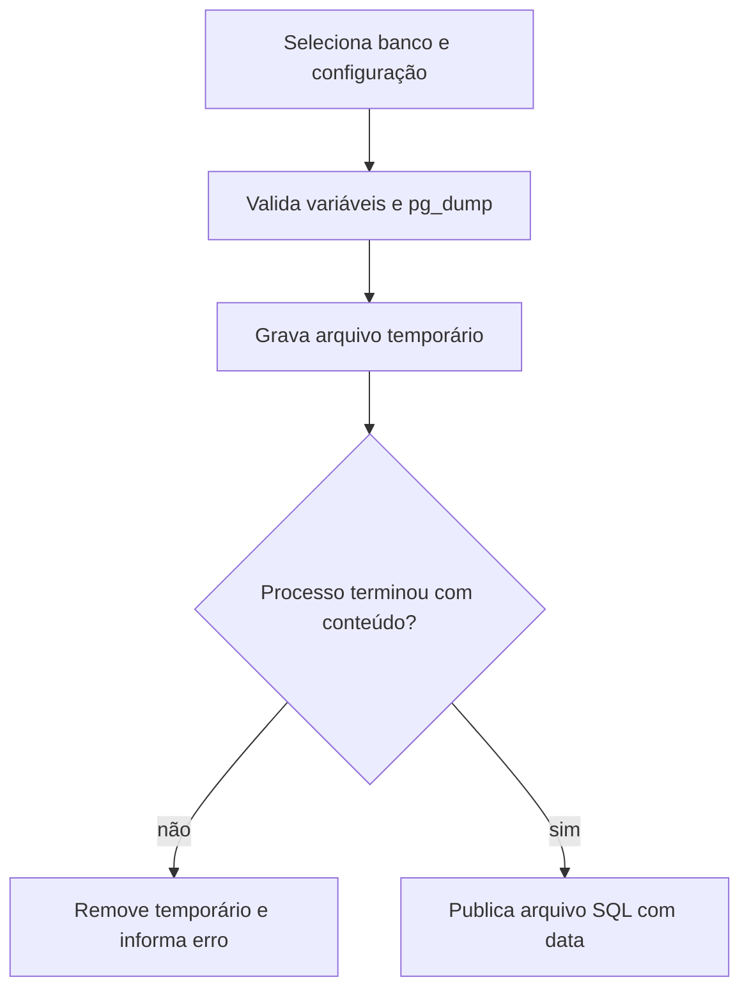

  

# Cópia PostgreSQL

O operador escolhe core, auth ou ambos e inicia o dump.

Configuração incompleta, executável ausente, erro no dump e arquivo vazio impedem a publicação do backup. Um arquivo final existente não é sobrescrito.
