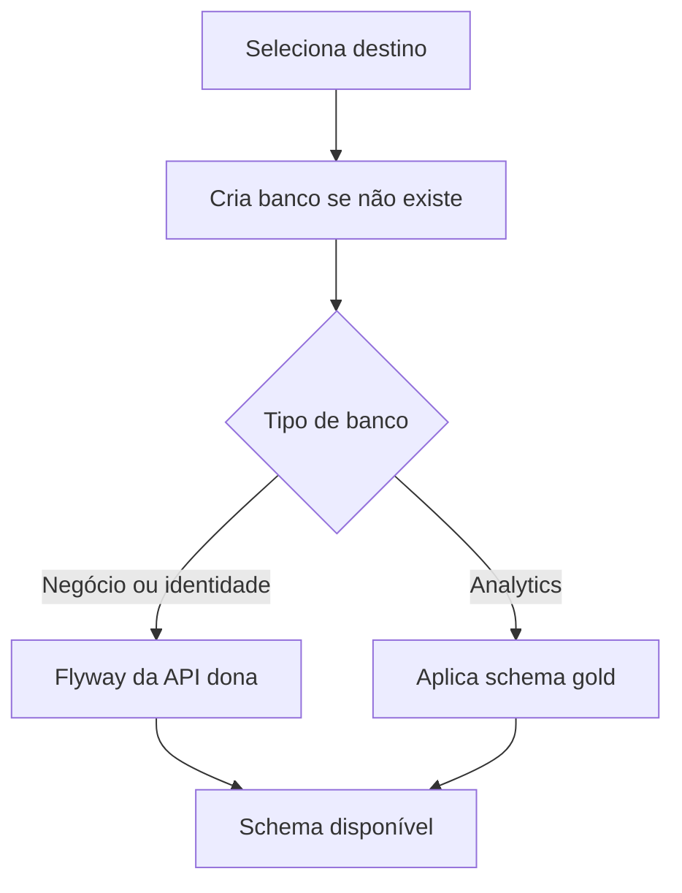

  

# Preparação de schema

A criação de um banco não substitui as migrations das APIs.

Banco inacessível, privilégio insuficiente e migration incompatível interrompem a operação. A criação de analytics não apaga um banco existente.
