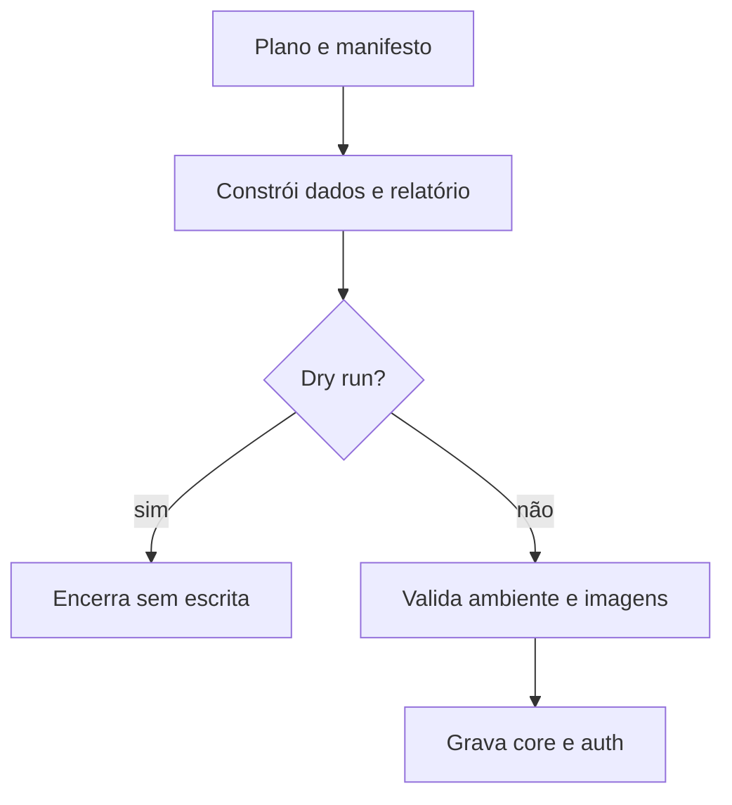

  

# Carga planejada

A carga constrói um conjunto determinístico e usa as imagens do catálogo de mocks.

Um ambiente não permitido, uma configuração ausente ou imagens insuficientes no modo estrito interrompem a carga, e em QA a carga exige um hash de senha próprio. A opção `--core-only` evita gravar a identidade, e a `--reset` remove apenas os identificadores gerados pelo plano.