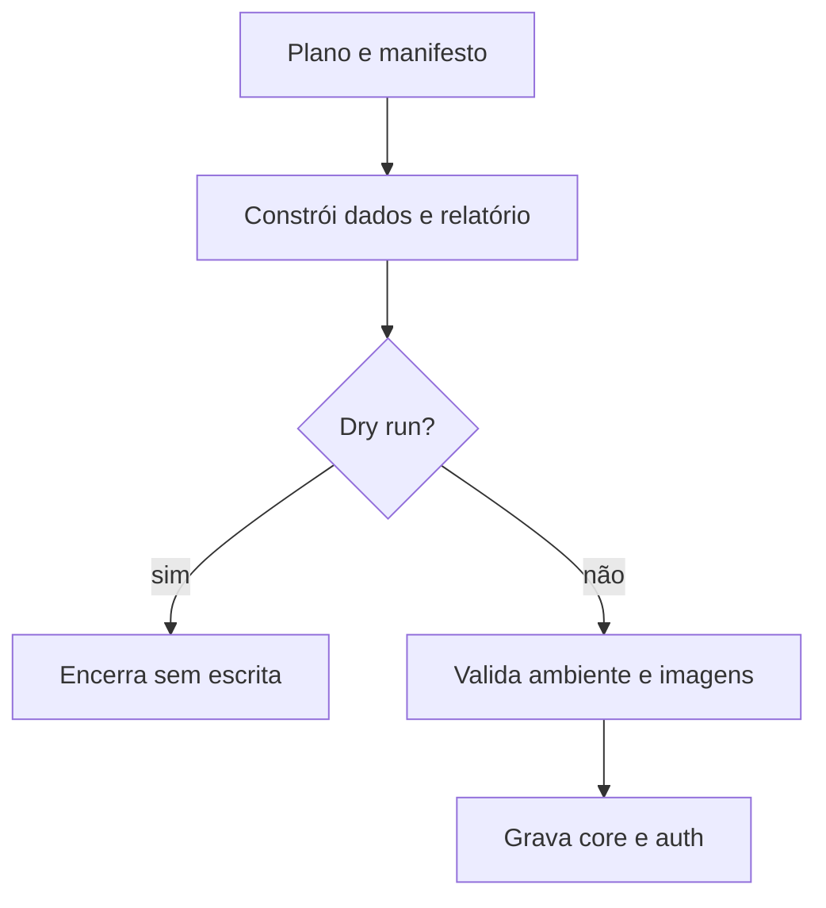

  

# Carga planejada

A carga constrói um conjunto determinístico e usa as imagens do catálogo de mocks.

Ambiente não permitido, configuração ausente e imagens insuficientes no modo estrito interrompem a carga. QA exige hash de senha próprio. `--core-only` evita gravar identidade. `--reset` remove somente os identificadores gerados pelo plano.
