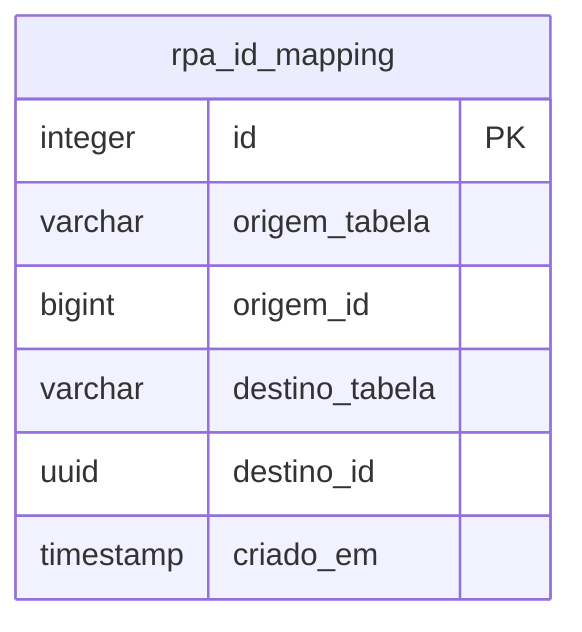

  

# Mapeamento no PostgreSQL

O ETL cria `rpa_id_mapping` no banco apontado por `DESTINO_DB_URL`. Essa tabela é seu controle de correspondência entre identificadores legados e UUIDs de destino. Os cadastros de negócio continuam pertencendo ao domínio central, e não são recriados como modelo completo neste documento.

O checklist previa que `database/` não se aplicaria, mas [`load.py`](https://github.com/Solierrr/database-rpa/blob/main/load.py) contém o DDL dessa tabela. A hipótese é que a rotina mantém o mapeamento e coordena alterações com o responsável pelo `coredb`. <!-- PENDENTE: 3 -->

## Colunas e índices

Todas as colunas são obrigatórias. `id` usa `SERIAL`, e `criado_em` usa `TIMESTAMP` com padrão `now()`, sem declaração de fuso horário.

| Coluna | Papel |
|---|---|
| `id` | chave primária da correspondência |
| `origem_tabela` | nome da entidade legada, com até cinquenta caracteres |
| `origem_id` | identificador numérico legado |
| `destino_tabela` | nome da entidade de destino, com até cinquenta caracteres |
| `destino_id` | UUID do registro de destino |
| `criado_em` | momento da inserção do mapeamento |

Além da chave primária, existe uma restrição única composta por `origem_tabela`, `origem_id` e `destino_tabela`. As inserções usam `ON CONFLICT` nessa combinação para não registrar a mesma correspondência novamente.

Não há foreign key para `destino_id`, pois ele aponta para tabelas distintas. Não há índice explícito adicional por UUID de destino, nem chave que diferencie duas instâncias de banco legado. Usar outra origem com os mesmos nomes e identificadores no mesmo destino requer decisão sobre o escopo do mapeamento. <!-- PENDENTE: 3 -->

## Leitura e escrita

A carga básica cria as correspondências de um `usuario` para `users`, `contact` e `person` junto com os registros. Na partida, os comandos de backfill recuperam as correspondências de usuário e contato a partir de um mapeamento antigo de pessoa.

A extração usa o mapeamento de `person` para decidir quais usuários ainda precisam de carga. As etapas complementares consultam os pais antes de inserir filhos. A etapa de fotos consulta o mapeamento para limitar a seleção a cadastros migrados.

Um registro legado pode ter vários destinos. `produto`, por exemplo, gera correspondências para `model`, `inventory` e `offer`. Um mesmo contato pode aparecer no mapeamento da pessoa e no do telefone escolhido. A restrição única não proíbe esse compartilhamento.

As gravações de negócio e suas correspondências ficam na transação da respectiva etapa. A garantia não abrange processos concorrentes que tenham lido o mesmo estado antes de inserir. O workflow serializa suas próprias execuções, sem impor bloqueio de banco global.

## Relação com os outros bancos

A origem contém as tabelas legadas consultadas, mas não recebe DDL nem escrita do ETL. O destino já deve possuir as tabelas de negócio usadas pelo SQL V29. Não há migrations de domínio neste repositório, nem validação automática da versão instalada. <!-- PENDENTE: 3 -->

O `authdb` não é conectado pela rotina. O identificador criado para `users.auth_id` não cria uma conta nem uma senha. O provisionamento está pendente. <!-- PENDENTE: 4 --> O mapa geral dos bancos é responsabilidade do [repositório de administração de dados](https://github.com/Solierrr/database-console), e o domínio de negócio pertence ao [cadastro central](https://github.com/Solierrr/api-core).
