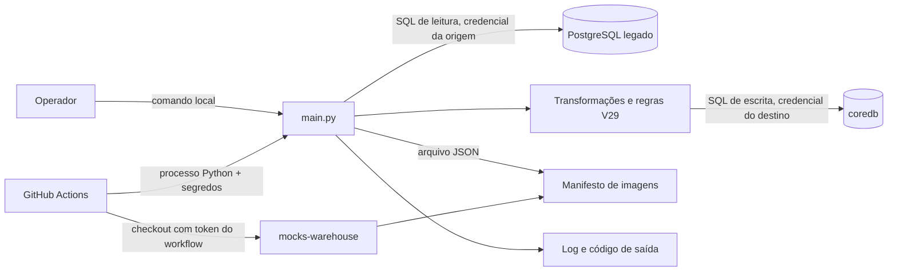

  

# Arquitetura

O ETL é um processo Python em lote. `main.py` prepara o mapeamento, importa usuários, executa as etapas complementares e associa imagens. Pandas extrai os registros, SQLAlchemy gerencia conexões e transações e psycopg2 acessa PostgreSQL. O processo grava diretamente no `coredb`, sem chamar as APIs de negócio.

## Arquivos

O repositório concentra as etapas em módulos na raiz.

| Caminho | Papel |
|---|---|
| `main.py` | ordem das etapas, log e propagação de falhas |
| `config.py`, `db.py` | configuração e engines com `pool_pre_ping` |
| `extract.py` | leitura de `usuario` e filtro pelos mapeamentos de `person` |
| `transform.py`, `load.py` | preparação e carga de `users`, `contact` e `person` |
| `extended_migration.py` | migração dos demais domínios e preservação de relações |
| `schema_v29.py` | usernames, slugs, marcas legadas e identificador de autenticação |
| `mock_data.py` | dados sintéticos semeados por entidade e identificador legado |
| `images.py` | seleção no manifesto e inserção das referências de fotos |
| `inspecionar.py` | listagem de tabelas e colunas dos dois bancos |
| `tests/` | testes unitários de usernames, slugs e catálogo de imagens |
| `.github/workflows/` | CI, lint e execução agendada |

## Integrações

A rotina usa credenciais de banco, sem JWT nem `X-Service-Key`.

| Com quem | Direção | Protocolo | Autenticação |
|---|---|---|---|
| PostgreSQL legado | somente consultas emitidas pela rotina | SQL via psycopg2 | credencial em `ORIGEM_DB_URL` |
| `coredb` | consultas, criação do mapeamento e gravações | SQL via psycopg2 | credencial em `DESTINO_DB_URL` |
| GitHub Actions | inicia o processo | execução de `python main.py` | permissões do repositório e secrets do workflow |
| `mocks-warehouse` | manifesto lido do checkout | arquivo JSON | `actions/checkout` com acesso de leitura |
| Cloudinary | referências de entrega gravadas nas fotos | URLs HTTPS montadas localmente | nenhuma chamada autenticada ao provedor nesta rotina |

O engine da origem não define uma transação PostgreSQL somente leitura. O código emite consultas, mas o bloqueio de escrita deve vir da credencial usada. Os ambientes e acessos autorizados precisam ser confirmados. <!-- PENDENTE: 1 -->

## Etapas e correspondências

[`load.py`](https://github.com/Solierrr/database-rpa/blob/main/load.py) cria e recompõe o [mapeamento](../database/POSTGRES.md). A extração consulta todos os usuários da origem e elimina os que já têm correspondência para `person`. A transformação cria UUIDs e campos obrigatórios. A carga grava pessoas e seus mapeamentos na mesma transação.

As etapas complementares seguem a ordem dos pais antes dos filhos.

| Ordem | Origem | Destino principal |
|---|---|---|
| 1 | `telefone`, `perfil` | atualização de `contact.phone` e `users.avatar` |
| 2 | `endereco` | `address` |
| 3 | `fornecedor`, `empresa_demandante` | `company`, `business_contact`, `supplier`, `requester`, vínculos e cargos |
| 4 | endereços dos demandantes | `local_unit` |
| 5 | `projeto`, `usuario_projeto` | `technical_project` do dono |
| 6 | `profissional` | `technician`, `profession`, `technician_affiliation` |
| 7 | `plano`, `assinatura` | `company_plans`, `subscription` |
| 8 | `produto`, `equipamento_eletrico` | `brand`, `model`, `inventory`, `offer` |
| 9 | `qualificacao` | `professional_registration` ou `certification` |

Cada função complementar abre sua própria transação. Uma falha posterior não desfaz etapas já confirmadas. Não há transação distribuída com a origem nem bloqueio global no banco. O grupo de concorrência do workflow serializa execuções daquele workflow, mas não impede uma execução local simultânea.

## Regras de transformação

`schema_v29.py` deriva usernames de e-mail, nome ou identificador legado e evita colisões com sufixos. Slugs de empresa, técnico e oferta são normalizados e consultados no destino antes da inserção. UUIDs são aleatórios na criação, e a estabilidade entre execuções depende do mapeamento persistido.

As empresas são reaproveitadas pelo CNPJ, sem mudar o `company.type` já gravado, e o vínculo do responsável usa `ADMIN`, de modo que outro vínculo empresarial já existente faz a nova associação ser ignorada. A decisão de negócio para esses casos continua pendente. <!-- PENDENTE: 5 -->

Os produtos exigem `equipamento_eletrico`, e a largura e o comprimento são convertidos de milímetros para metros, com a eficiência limitada entre zero e cem. Um estoque ausente ou negativo vira zero e um preço ausente ou não positivo recebe um valor sintético, enquanto as marcas criadas ficam privadas e legadas e os modelos recebem `PANEL`, `MONOCRYSTALLINE` e `UNDER_ANALYSIS`.

As assinaturas traduzem as situações conhecidas e usam `PAID` para as que não são reconhecidas, e uma data inicial ou uma renovação automática ausentes recebem valores padrão. As qualificações com marcadores de conselho viram registro profissional e as demais viram certificação, e um registro sem validade recebe a data de emissão acrescida de 3.650 dias, preenchimentos que ainda precisam da validação do responsável. <!-- PENDENTE: 2 -->

## Dados e limites de propriedade

O repositório mantém `rpa_id_mapping` dentro do banco de negócio. O schema dos demais domínios pertence ao cadastro central e é mantido no `database-console`. As regras locais citam V29, sem verificação automática da versão do destino. A propriedade e a compatibilidade desse contrato precisam ser definidas. <!-- PENDENTE: 3 -->

O fluxo posterior de dados para análise está em [ANALYTICS_SYNC.md](https://github.com/Solierrr/docs-warehouse/blob/main/docs/flows/ANALYTICS_SYNC.md). Ele é executado por outro serviço e não é disparado por este ETL.

## Observabilidade e versão

O processo registra início, contagens, avisos, falhas e término em `rpa_etl.log` e no console. Exceções são relançadas para produzir código de saída diferente de zero. O Actions guarda o arquivo por quatorze dias quando a configuração de conexão permitiu iniciar o job.

Não há servidor HTTP, OpenAPI, health check, endpoint de versão nem instrumentação OpenTelemetry no código. O commit executado identifica a revisão. A main analisada é [`c298cdec`](https://github.com/Solierrr/database-rpa/commit/c298cdecba70a12ab506edfc926d4af07ad1e528), conferida em 2026-10-30.
