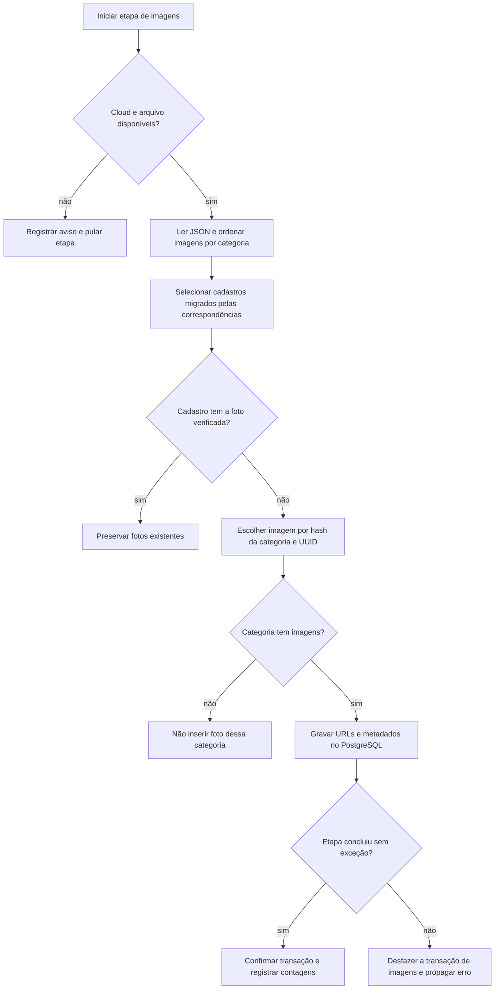

  

# Associação de imagens

A etapa final lê o manifesto e associa referências de fotos já publicadas aos cadastros migrados elegíveis. O código monta as URLs do Cloudinary e grava as referências no banco, sem enviar arquivos ao provedor.

Para pessoas, a verificação procura foto de perfil. A categoria prioriza profissional, depois fornecedor e, por fim, cliente. Para empresas, qualquer foto existente exclui o cadastro da seleção. Empresas novas recebem perfil e banner quando as categorias têm imagens. Modelos sem foto recebem uma imagem principal e duas de galeria quando disponíveis.

A escolha é determinística para o UUID persistido. Sem mapeamentos preservados, uma nova carga pode criar UUIDs diferentes e escolher outras imagens. Catálogo com poucas imagens pode repetir a escolha ao percorrer os offsets.

## Casos de erro

- Cloud ausente ou arquivo não encontrado pula a etapa com aviso.
- JSON inválido ou estrutura sem os campos esperados pode encerrar a etapa com erro.
- Categoria ausente não produz referência de foto.
- Falha SQL desfaz a transação das imagens, mas não as etapas de negócio anteriores.
- Empresa ou modelo com conjunto parcial de fotos não recebe as fotos faltantes, pois a seleção exige ausência de qualquer foto nesses cadastros.

O catálogo é mantido no [repositório de imagens](https://github.com/Solierrr/mocks-warehouse). O que este ETL faz com ele está limitado às referências gravadas no destino.
