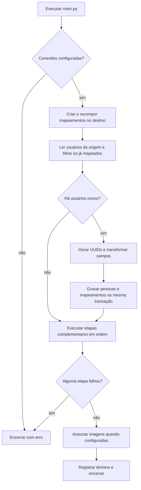

  

# Importação do legado

O processo começa por execução local ou pelo workflow. Ele prepara as correspondências, importa pessoas ainda não mapeadas e percorre os demais domínios em ordem de dependência. Cada etapa confirma sua transação antes de seguir.

A origem recebe somente consultas SQL emitidas pelo programa. O destino recebe o DDL de controle e as alterações de negócio. As consultas usam as credenciais das respectivas URLs de conexão, sem chamadas autenticadas às APIs.

As etapas complementares executam mesmo quando não há pessoas novas. O mapeamento permite reaproveitar registros, mas cada etapa decide o que atualizar ou pular. O telefone escolhido pode ser atualizado novamente. As demais limitações estão em [STATUS.md](../docs/STATUS.md).

## Casos de erro

- Ausência de configuração ou falha de conexão impede a carga.
- Tabela ou coluna ausente, inclusive as de projeto, provoca erro SQL.
- Violação de restrição no destino desfaz a transação da etapa em execução.
- Etapas anteriores já confirmadas permanecem gravadas após falha posterior.
- Relação obrigatória sem mapeamento pode fazer o registro ser ignorado, com aviso em alguns caminhos.
- Concorrência externa ao workflow não é bloqueada pela tabela de correspondência.

O uso posterior desses dados na análise segue [ANALYTICS_SYNC.md](https://github.com/Solierrr/docs-warehouse/blob/main/docs/flows/ANALYTICS_SYNC.md). Esta rotina não dispara a sincronização para análise.
