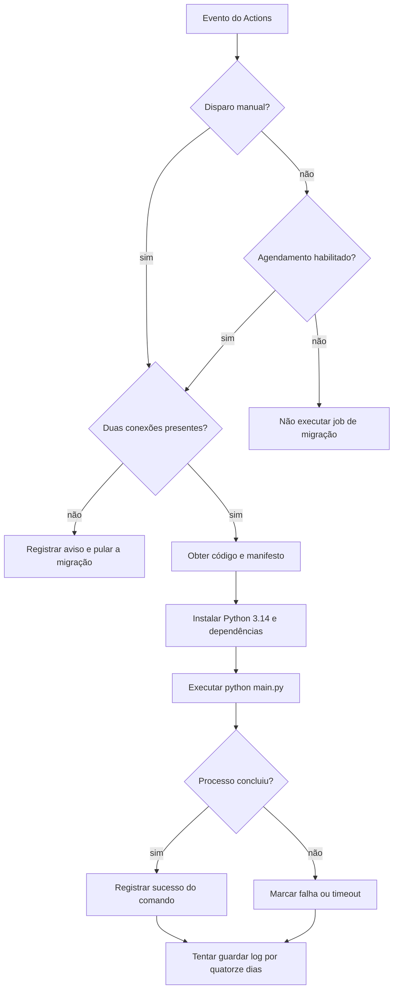

  

# Execução pelo workflow

O workflow recebe um disparo manual ou o evento diário às 06:00 UTC. Ele verifica a habilitação e as conexões antes de instalar dependências e executar a migração.

A variável `RPA_SCHEDULE_ENABLED` controla apenas o evento agendado. A execução manual ignora essa condição, mas continua dependendo das duas conexões. O grupo de concorrência serializa execuções desse workflow, com timeout de trinta minutos por job.

## Casos de erro

- Secrets ausentes não provocam falha de migração, pois o comando não chega a ser executado.
- Falha de checkout, acesso ao manifesto ou instalação impede iniciar o ETL.
- Exceção no programa faz o comando falhar. As transações anteriores podem ter sido confirmadas.
- Timeout interrompe o job, sem desfazer etapas de banco já concluídas.
- Log ausente é ignorado pelo upload. O artefato não substitui uma conferência das contagens e avisos.

Os destinos e a configuração autorizada estão em [DEPLOY.md](../docs/DEPLOY.md), com as dúvidas de ambiente registradas na pendência 1.
