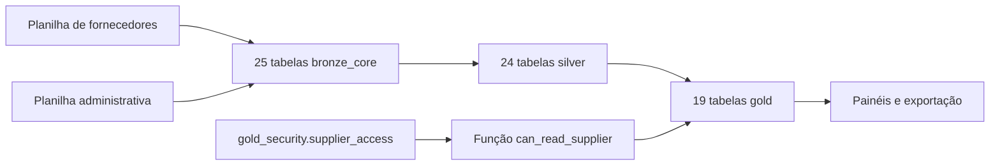
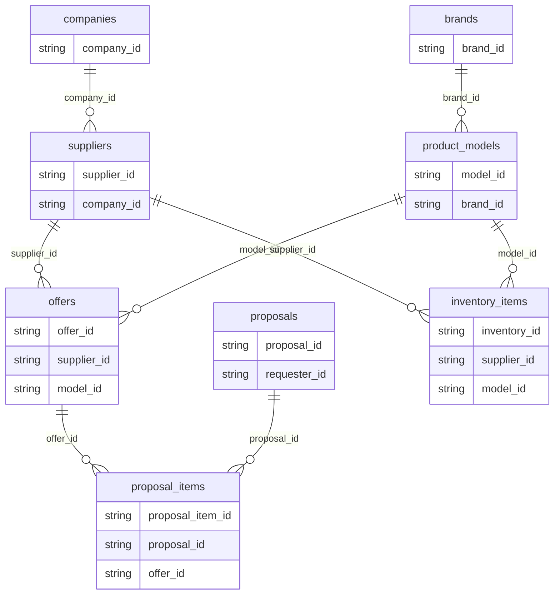

  

# Modelo das camadas analíticas

O notebook grava tabelas Delta gerenciadas, e o módulo define o catálogo padrão `workspace` e os schemas `bronze_core`, `silver`, `gold` e `gold_security`. O job usa o catálogo `analytics` e os painéis usam `workspace.gold`, e o contrato Gold deste repositório é a referência que o exportador deve seguir.

## Bronze

O leitor exige as colunas abaixo, adapta aliases de nomes antigos e preserva outras colunas existentes. Cada linha mantém a entrada sem aplicar ainda as regras de qualidade da Silver. A aba física `company_plans` é publicada como `company_plan`.

| Tabela | Planilha | Colunas obrigatórias |
|---|---|---|
| `brand` | fornecedores | `id`, `owner_company_id`, `name`, `normalized_name`, `visibility`, `is_archived`, `is_legacy`, `created_at`, `updated_at` |
| `model` | fornecedores | `id`, `brand_id`, `model_name`, `status`, `product_type`, `infrastructure_type`, `type`, `material`, `power_wp`, `efficiency`, `width`, `length`, `weight` |
| `supplier` | fornecedores | `id`, `company_id`, `status`, `business_type` |
| `offer` | fornecedores | `id`, `supplier_id`, `model_id`, `unit_price`, `availability`, `expires_at`, `slug`, `discount_percentage`, `commercial_status` |
| `inventory` | fornecedores | `id`, `supplier_id`, `model_id`, `quantity` |
| `proposal` | fornecedores | `id`, `requester_id`, `supplier_id`, `status`, `total_amount`, `created_at`, `updated_at` |
| `proposal_item` | fornecedores | `id`, `proposal_id`, `offer_id`, `quantity`, `negotiated_unit_price`, `discount` |
| `company` | admins | `id`, `type`, `status`, `trade_name`, `corporate_name`, `slug` |
| `person` | admins | `id`, `user_id` |
| `requester` | admins | `id`, `company_id`, `business_type` |
| `technician` | admins | `id`, `person_id`, `slug` |
| `technician_affiliation` | admins | `id`, `technician_id`, `company_id`, `affiliation_type`, `is_active` |
| `user_company` | admins | `id`, `company_id`, `user_id`, `job_position_id` |
| `proposal_unit` | admins | `id`, `proposal_item_id`, `local_unit_id`, `quantity` |
| `local_unit` | admins | `id`, `requester_id`, `address_id`, `location_type` |
| `professional_review` | admins | `id`, `technician_id`, `technical_service_id`, `rating`, `is_active`, `created_at` |
| `project_activity` | admins | `id`, `technical_project_id`, `technical_service_id`, `type`, `status`, `starts_at`, `ends_at`, `is_onsite` |
| `service_contract` | admins | `id`, `technical_service_id`, `delivery_deadline_date`, `has_insurance`, `has_utility_approval` |
| `service_executor` | admins | `id`, `technical_service_id`, `technician_affiliation_id`, `function` |
| `technical_project` | admins | `id`, `requester_id`, `local_unit_id`, `owner_company_id`, `owner_user_id`, `name`, `status`, `is_archived`, `created_at`, `starts_at`, `ends_at`, `location_state`, `location_city` |
| `technical_service` | admins | `id`, `technical_project_id`, `status`, `scheduled_at`, `created_at`, `accepted_at`, `ends_at` |
| `charge` | admins | `id`, `subscription_id`, `amount`, `payment_method`, `status`, `due_date`, `paid_at` |
| `company_plan` | admins | `id`, `name`, `price`, `cycle` |
| `subscription` | admins | `id`, `supplier_id`, `company_plan_id`, `status`, `has_auto_renewal`, `starts_at`, `ends_at` |
| `energy_bill` | admins | `id`, `local_unit_id`, `consumption`, `amount` |

## Silver

As 23 especificações diretas e a junção especial de técnicos com pessoas formam 24 tabelas, com os identificadores em texto, os textos vazios convertidos em null e as regras de situação escritas em maiúsculas.

| Tabela | Origem Bronze | Colunas publicadas |
|---|---|---|
| `companies` | `company` | `company_id`, `company_type`, `company_status`, `trade_name`, `corporate_name`, `slug` |
| `suppliers` | `supplier` | `supplier_id`, `company_id`, `supplier_status`, `business_type` |
| `requesters` | `requester` | `requester_id`, `company_id`, `business_type` |
| `technician_affiliations` | `technician_affiliation` | `affiliation_id`, `technician_id`, `company_id`, `affiliation_type`, `is_active` |
| `company_memberships` | `user_company` | `membership_id`, `company_id`, `user_id`, `position_id` |
| `brands` | `brand` | `brand_id`, `owner_company_id`, `brand_name`, `normalized_name`, `visibility`, `is_archived`, `is_legacy`, `created_at`, `updated_at` |
| `product_models` | `model` | `model_id`, `brand_id`, `model_name`, `model_status`, `product_type`, `infrastructure_type`, `panel_type`, `material`, `power_wp`, `efficiency`, `width`, `length`, `weight` |
| `offers` | `offer` | `offer_id`, `supplier_id`, `model_id`, `unit_price`, `availability`, `expires_at`, `slug`, `discount_percentage`, `commercial_status` |
| `inventory_items` | `inventory` | `inventory_id`, `supplier_id`, `model_id`, `quantity` |
| `proposals` | `proposal` | `proposal_id`, `requester_id`, `supplier_id`, `proposal_status`, `total_amount`, `created_at`, `updated_at` |
| `proposal_items` | `proposal_item` | `proposal_item_id`, `proposal_id`, `offer_id`, `quantity`, `negotiated_unit_price`, `discount` |
| `proposal_units` | `proposal_unit` | `proposal_unit_id`, `proposal_item_id`, `local_unit_id`, `quantity` |
| `local_units` | `local_unit` | `local_unit_id`, `requester_id`, `address_id`, `location_type` |
| `technical_projects` | `technical_project` | `project_id`, `requester_id`, `local_unit_id`, `owner_company_id`, `owner_user_id`, `project_name`, `project_status`, `is_archived`, `created_at`, `starts_at`, `ends_at`, `location_state`, `location_city` |
| `project_activities` | `project_activity` | `activity_id`, `project_id`, `service_id`, `activity_type`, `activity_status`, `starts_at`, `ends_at`, `is_onsite` |
| `technical_services` | `technical_service` | `service_id`, `project_id`, `service_status`, `scheduled_at`, `created_at`, `accepted_at`, `ends_at` |
| `service_contracts` | `service_contract` | `contract_id`, `service_id`, `delivery_deadline_date`, `has_insurance`, `has_utility_approval` |
| `service_executors` | `service_executor` | `executor_id`, `service_id`, `affiliation_id`, `executor_function` |
| `professional_reviews` | `professional_review` | `review_id`, `technician_id`, `service_id`, `rating`, `is_active`, `created_at` |
| `company_plans` | `company_plan` | `plan_id`, `plan_name`, `plan_price`, `billing_cycle` |
| `subscriptions` | `subscription` | `subscription_id`, `supplier_id`, `plan_id`, `subscription_status`, `has_auto_renewal`, `starts_at`, `ends_at` |
| `subscription_charges` | `charge` | `charge_id`, `subscription_id`, `amount`, `payment_method`, `charge_status`, `due_date`, `paid_at` |
| `energy_bills` | `energy_bill` | `energy_bill_id`, `local_unit_id`, `consumption`, `amount` |
| `technicians` | `technician` e `person` | `technician_id`, `person_id`, `user_id`, `technician_slug` |

Valores monetários e avaliações usam decimal com duas casas. Medidas físicas e consumo usam quatro casas. Quantidade e disponibilidade usam bigint. Booleanos aceitam as representações textuais implementadas e datas e timestamps usam conversão validada. Valores com perda de casas, datas inválidas e horários descartados em campos date são rejeitados quando a regra detecta informação não preservada.

IDs vazios e duplicados são excluídos. Disponibilidade e estoque exigem valor não negativo. Quantidades de item e unidade de proposta exigem valor positivo. Aceite ou conclusão de serviço não pode anteceder criação, e conclusão não pode anteceder aceite quando ambos existem. Não há garantia relacional completa só por essas validações.

## Relações lógicas da Silver

O diagrama mostra o recorte de catálogo e negociação. Os identificadores representam vínculos lógicos, sem PK ou FK declaradas pelo escritor Delta.

## Gold

As 19 tabelas guardam os resultados atuais e são substituídas a cada atualização, com os nomes definidos pelos construtores em `note_gold.py`, e as dez que têm o prefixo `kpi_supplier_` recebem o filtro por fornecedor.

| Tabela | Grão | Conteúdo |
|---|---|---|
| `kpi_admin_registrations` | Uma linha global | Fornecedores ativos e demandantes cadastrados |
| `kpi_admin_models_by_status` | Situação do modelo | Modelos distintos |
| `kpi_admin_proposals_by_status` | Situação da proposta | Propostas distintas |
| `kpi_supplier_offers_by_status` | Fornecedor e situação comercial | Ofertas distintas |
| `kpi_supplier_stock_by_model` | Fornecedor e modelo | Marca, modelo e unidades em estoque |
| `kpi_requester_summary` | Demandante | Empresa, unidades, propostas e projetos |
| `kpi_requester_proposals_by_status` | Demandante e situação | Propostas distintas |
| `kpi_requester_projects_by_status` | Demandante e situação | Projetos distintos |
| `kpi_professional_summary` | Vínculo e técnico | Empresa, atividade do vínculo e serviços atribuídos |
| `kpi_professional_services_by_status` | Vínculo, técnico e situação | Serviços distintos |
| `kpi_professional_reviews` | Técnico | Contagem e média de avaliações ativas |
| `kpi_supplier_offers_summary` | Fornecedor e data de referência | Ofertas totais, ativas, preços médios, disponibilidade e vencimentos |
| `kpi_supplier_offer_details` | Oferta | Fornecedor, modelo, marca, preço, disponibilidade, vencimento e situação |
| `kpi_supplier_stock_summary` | Fornecedor | Unidades em estoque e modelos com estoque positivo |
| `kpi_supplier_proposals_by_status` | Fornecedor e situação | Propostas recebidas distintas |
| `kpi_supplier_proposals_summary` | Fornecedor | Propostas abertas e encerradas, taxa de aceite, cobertura de preços e valor negociado aceito |
| `kpi_supplier_accepted_value_by_model` | Fornecedor e modelo | Valor negociado aceito |
| `kpi_supplier_accepted_value_by_month` | Fornecedor e mês de criação da proposta | Valor negociado aceito, com data aproximada |
| `kpi_supplier_accepted_offers_by_date` | Fornecedor, oferta, modelo e data de criação | Contagem de propostas aceitas, com data aproximada |

O fornecedor das propostas é derivado por item e oferta, e o valor aceito multiplica o preço negociado pela quantidade, sem reaplicar o desconto. As taxas com denominador zero ficam nulas e um preço ausente não é substituído por estimativa, enquanto as datas dos indicadores temporais são aproximações pela data de criação, já que não há histórico efetivo de aceite.

## Segurança e índices

`gold_security.supplier_access` é tabela Delta com `principal`, `scope`, `supplier_id`, `active`, `validated_by` e `validated_at`. Todos os campos exceto fornecedor têm NOT NULL no SQL de provisionamento. Não há PK, FK ou índice secundário explícito criado no código das camadas.

A função de filtro, que usa `session_user()`, libera a linha para um ADMIN ativo ou para um SUPPLIER ativo associado a exatamente um fornecedor, igual ao da linha. A tabela de acesso começa vazia, e as identidades do job e do exportador também precisam ter o acesso validado.

O escritor aplica row filter na criação das dez tabelas de fornecedor, e as demais tabelas usam grants próprios para o consumo final, enquanto o executor local ignora esse filtro, conforme o metadado da saída.

## Escritores, leitores e ciclo

O notebook escreve as três camadas, com a Silver lendo a Bronze e a Gold lendo a Silver, e os painéis e o exportador são os leitores previstos da Gold. O notebook não define CDC nem agendamento de carga contínua e não cria TTL nem tabela de auditoria dos rejeitados, relatando a qualidade apenas no terminal.

As substituições são feitas tabela a tabela, e uma interrupção pode deixar as camadas com atualizações diferentes, por isso a virada evita disputa com as pipelines antigas e com a carga Bronze automática.

Fontes em [Bronze](https://github.com/Solierrr/databricks-stocker/blob/main/pipelines/00_medallion/transformations/note_bronze.py), [Silver](https://github.com/Solierrr/databricks-stocker/blob/main/pipelines/00_medallion/transformations/note_silver.py), [Gold](https://github.com/Solierrr/databricks-stocker/blob/main/pipelines/00_medallion/transformations/note_gold.py), [catálogo](https://github.com/Solierrr/databricks-stocker/blob/main/pipelines/00_medallion/transformations/note_catalog.py) e [segurança](https://github.com/Solierrr/databricks-stocker/blob/main/security/supplier_access.sql).
