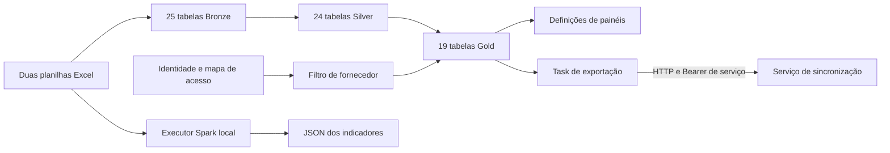

  

# Arquitetura

Um notebook orquestra módulos PySpark para ingestão manual, normalização e cálculo. O job versionado executa esse notebook e depois chama a exportação. O fluxo atual não é código-fonte de pipeline Lakeflow e não usa as antigas pastas de SQL.

## Módulos

| Caminho | Responsabilidade |
|---|---|
| `pipelines/00_medallion/transformations/my_transformation.py` | Parâmetros, proteção de substituição e ordem das escritas |
| `note_bronze.py` na mesma pasta | Abas, aliases e colunas obrigatórias |
| `note_silver.py` na mesma pasta | Projeções, tipos e validação de qualidade |
| `note_gold.py` na mesma pasta | Construtores dos 19 indicadores |
| `note_catalog.py` na mesma pasta | Catálogo e schemas |
| `run_local.py` | Adaptadores Excel, Spark local e saída JSON |
| `exports/` | Job e notebook que chama a API |
| `security/` | Tabela de principais e função de filtro |
| `dashboards/` | Duas definições exportadas de painéis |
| `tests/` | Contratos e validações locais |

## Integrações

| Relação | Protocolo | Autenticação |
|---|---|---|
| Operação envia planilhas | Upload ao volume Unity Catalog | Identidade do workspace |
| Notebook lê e escreve camadas | Spark e Delta | Principal do job |
| Fornecedor consulta Gold | SQL Databricks | Identidade e row filter |
| Notebook exportador chama sincronização | HTTP POST | Bearer fixo lido do secret scope |
| Painéis consultam Gold | Dataset Databricks | Permissões de publicação e execução |

O repositório não tem API HTTP, OpenAPI nem banco de negócio próprios, e os objetos analíticos estão em [DATABRICKS.md](../database/DATABRICKS.md). O fluxo integrado está na [cópia analítica](https://github.com/Solierrr/docs-warehouse/blob/main/docs/flows/ANALYTICS_SYNC.md), e as diferenças atuais estão descritas aqui.

## Escrita e consistência

O `source_mode` aceita apenas `manual`. A Bronze lê 25 abas, adapta os cabeçalhos antigos e mantém as demais colunas, a Silver valida as fontes antes de escrever as 24 projeções e a Gold calcula 19 tabelas, com substituições tabela a tabela e sem uma transação global entre as três camadas.

A proteção padrão permite substituir tabelas Delta gerenciadas existentes, mas recusa views e objetos de outro formato. `allow_replace_existing` remove explicitamente essa barreira. O parâmetro falso não significa proibir toda substituição.

As dez tabelas de fornecedor recebem row filter na própria criação. As outras nove não recebem essa política no escritor. O mapa de acesso começa vazio e exige provisionamento. Não há isolamento de usuário por simplesmente aplicar filtro visual no painel. <!-- PENDENTE: 4 -->

## Execução local

O executor usa openpyxl para representar células como texto e adapta o runtime. Reutiliza funções de transformação, substitui tabelas persistentes por views temporárias e coleta Gold para JSON. Ele não publica Delta, não aplica row filter e não chama a API de exportação.

A saída é substituída só após calcular todos os indicadores. Decimais viram texto para preservar precisão. Falha pode deixar um JSON anterior intacto, então a data de geração precisa ser conferida.

## Configuração e observabilidade

O catálogo padrão do módulo é `workspace`, o job usa `analytics`, os painéis apontam para `workspace.gold` e o exportador atual exige `workspace.gold_core` com nomes diferentes. Não há adaptação automática entre esses contratos. <!-- PENDENTE: 1 -->

O processamento informa no terminal as contagens de rejeição e as linhas de cada tabela, sem rota de health nem serviço sempre ativo, e a main analisada é a `4b1ce020`, de 2026-10-31. As fontes principais são o [orquestrador](https://github.com/Solierrr/databricks-stocker/blob/main/pipelines/00_medallion/transformations/my_transformation.py), a [Silver](https://github.com/Solierrr/databricks-stocker/blob/main/pipelines/00_medallion/transformations/note_silver.py), o [executor local](https://github.com/Solierrr/databricks-stocker/blob/main/run_local.py) e o [job](https://github.com/Solierrr/databricks-stocker/blob/main/exports/medallion_export_job.json).