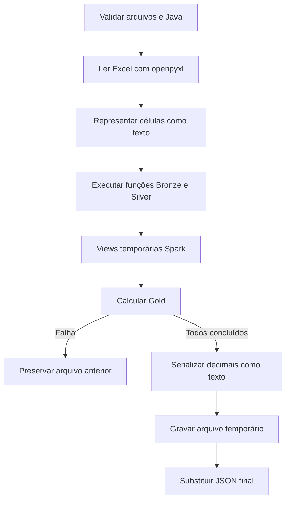

  

# Cálculo local dos indicadores

O executor local reutiliza as transformações e gera JSON sem tocar no workspace ou chamar o exportador.

## Falhas e limites

Não há row filter local, escrita Delta ou exportação HTTP. Fórmulas não são recalculadas. Um resultado anterior pode permanecer após falha, então conferir geração e conclusão. O conjunto local pode conter vários fornecedores.

Fonte em [implementação](https://github.com/Solierrr/databricks-stocker/blob/main/run_local.py). O contexto integrado está em [cópia analítica](https://github.com/Solierrr/docs-warehouse/blob/main/docs/flows/ANALYTICS_SYNC.md).
