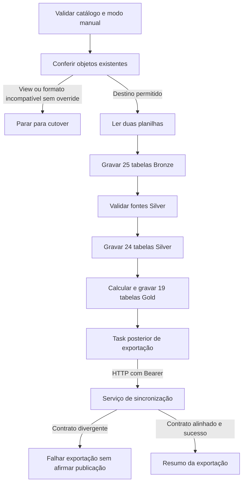

  

# Transformação no workspace

O job executa uma transformação manual e chama a exportação somente depois do sucesso da primeira task.

## Falhas e limites

A ausência de aba ou coluna impede a respectiva leitura. Uma falha pode deixar tabelas anteriores atualizadas. O job declara uma execução concorrente. A primeira task concluída não comprova compatibilidade com o manifesto do serviço de destino. <!-- PENDENTE: 1 -->

Fonte em [implementação](https://github.com/Solierrr/databricks-stocker/blob/main/pipelines/00_medallion/transformations/my_transformation.py). O contexto integrado está em [cópia analítica](https://github.com/Solierrr/docs-warehouse/blob/main/docs/flows/ANALYTICS_SYNC.md).
