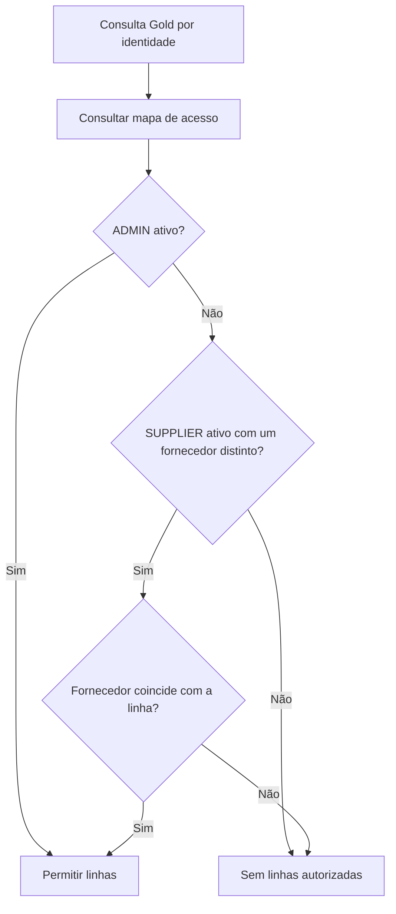

  

# Acesso por fornecedor

No Databricks, as tabelas de fornecedor usam uma função por identidade antes de disponibilizar as linhas.

## Falhas e limites

Vínculos ausentes, inativos ou ambíguos não liberam linhas de fornecedor. A função não substitui grants e políticas dos outros indicadores. Execução local não usa esse controle. Confirmar a identidade efetiva de execução dos painéis. <!-- PENDENTE: 4 -->

Fonte em [implementação](https://github.com/Solierrr/databricks-stocker/blob/main/security/supplier_access.sql). O contexto integrado está em [cópia analítica](https://github.com/Solierrr/docs-warehouse/blob/main/docs/flows/ANALYTICS_SYNC.md).
